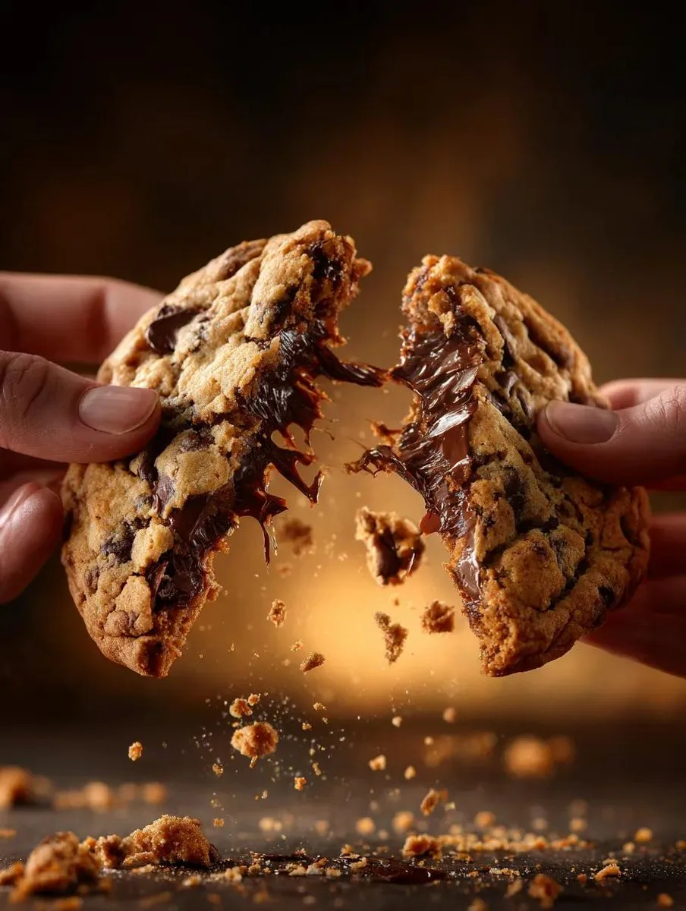

# Sharon Riley — by @Just_sharon7

[← Back to Examples from X](../../EXAMPLES.md) · Category: Food & Drink · Model: `Nano Banana`

<a href="https://x.com/Just_sharon7/status/2011261271946187209"></a>

Original post: **[@Just_sharon7 on X](https://x.com/Just_sharon7/status/2011261271946187209)** · Creator: [Sharon Riley](https://x.com/Just_sharon7)

## Prompt

```text
{
  "model": "Nano Banana / Gemini-style",
  "aspect_ratio": "3:4",
  "render_mode": "raw",
  "series": [
    {
      "index": "1/5",
      "prompt": "two hands pulling apart a grilled cheese sandwich, strands of melted cheddar stretching dramatically between the halves, toasted bread edges crisp and golden, crumbs falling mid-air, warm cozy light, cinematic food action photography",
      "category": "cheese pull",
      "lighting": "warm cozy cinematic light",
      "detail_level": "high-detail"
    },
    {
      "index": "2/5",
      "prompt": "two hands breaking a warm chocolate chip cookie in half, melted chocolate strands stretching between the pieces, crumbs falling mid-air, cozy warm light, high-detail food action photography",
      "category": "chocolate stretch",
      "lighting": "soft cozy warm light",
      "detail_level": "high-detail"
    },
    {
      "index": "3/5",
      "prompt": "two hands splitting a peanut butter and jelly sandwich in half, thick peanut butter and jam stretching in gooey strands, toasted bread edges crisp, crumbs falling mid-air, warm cozy backlight, high-detail food action photography",
      "category": "gooey spread pull",
      "lighting": "warm backlight",
      "detail_level": "high-detail"
    },
    {
      "index": "4/5",
      "prompt": "two hands tearing a syrup-soaked Belgian waffle, caramel strands stretching between pieces, crumbs and syrup droplets suspended mid-air, golden hour backlight, cozy cinematic food action photography",
      "category": "syrup stretch",
      "lighting": "golden hour backlight",
      "detail_level": "ultra-detailed"
    },
    {
      "index": "5/5",
      "prompt": "two hands breaking a southern-style buttery biscuit in half, hot steam rising, melted butter pooling inside the cracks, crumbs falling mid-air, warm country kitchen light, cinematic high-detail food action photography",
      "category": "steam & butter",
      "lighting": "warm kitchen light",
      "detail_level": "ultra-detailed"
    }
  ]
}
```

## Try it

Paste the prompt into **[vinano.ai](https://vinano.ai?utm_source=github&utm_medium=readme&utm_campaign=awesome-image-video-prompts-updating&utm_content=x-page-try)** to generate your own version.

> The image and prompt belong to [@Just_sharon7](https://x.com/Just_sharon7) and are shown here with credit for reference. Creators can ask for changes or removal by opening an issue.
