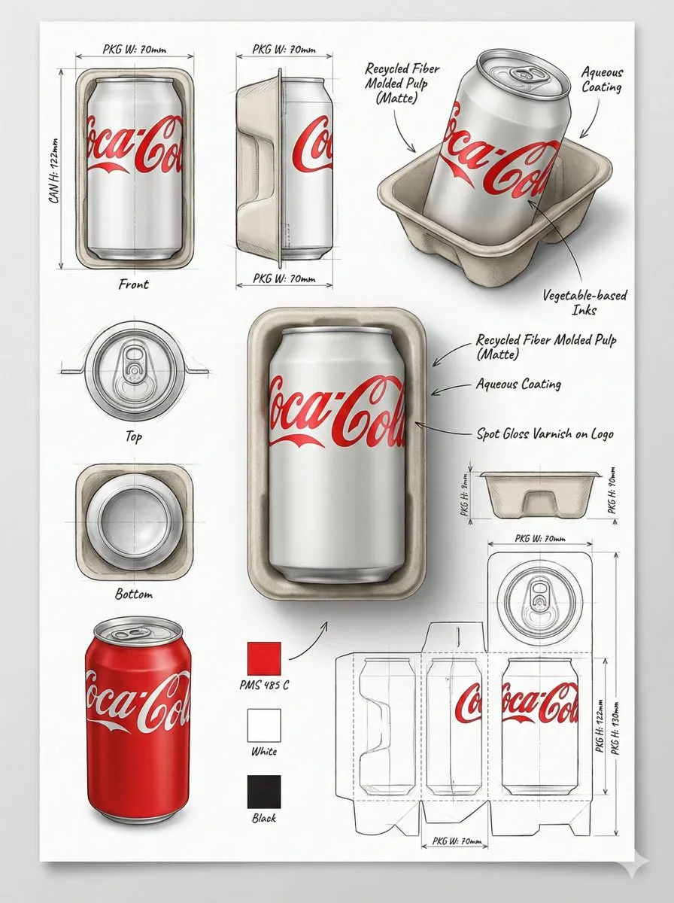

# 𝐌 — by @Strength04_X

[← Back to Community Examples](../../EXAMPLES.md) · Category: Product & Brand · Model: `Nano Banana`

<a href="https://x.com/Strength04_X/status/2017093337564746040"></a>

Source: **[@Strength04_X on X](https://x.com/Strength04_X/status/2017093337564746040)** · Creator: [𝐌](https://x.com/Strength04_X)

## Prompt

```text
Using the attached image, create a professional industrial packaging design illustration sheet for the packaging of [PRODUCT NAME]

Feature a centered hero 3D render with realistic materials, soft studio lighting, and commercial-grade finish quality.
Surround the hero render with technical views: front, side, top, bottom, angled perspective, and flat layout.

Include structural construction sketches, fold lines, seam details, and dimension arrows with measurements in millimeters.
Show materials and finishes (matte, glossy print, plastic, paper, glass, etc.) using handwritten-style annotations.
Add color swatches, realistic product illustrations, and subtle shadows.

Background should resemble clean sketchbook paper, combining realistic rendering with pencil sketch overlays.
Modern industrial design aesthetic, ultra-detailed, portfolio-ready presentation.

Stable Diffusion settings:
CFG: 7–9
Steps: 30–40
Sampler: DPM++
Resolution: 1024×1280 or higher
Aspect Ratio: 3:4
```

## Try it

Paste the prompt into **[vinano.ai](https://vinano.ai?utm_source=github&utm_medium=readme&utm_campaign=awesome-image-video-prompts-updating&utm_content=x-page-try)** to generate your own version.

> The image and prompt belong to @Strength04_X ([original post](https://x.com/Strength04_X/status/2017093337564746040)) and are shown here with credit for reference. Creators can ask for changes or removal by opening an issue.
