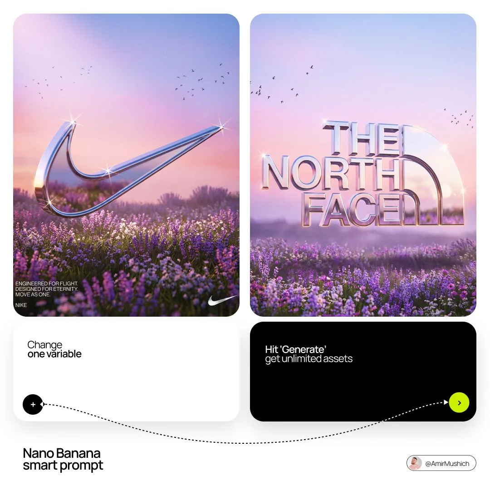

# AmirMušić — by @AmirMushich

[← Back to Community Examples](../../EXAMPLES.md) · Category: Product & Brand · Model: `Nano Banana`

<a href="https://x.com/AmirMushich/status/2037605625463550080"></a>

Source: **[@AmirMushich on X](https://x.com/AmirMushich/status/2037605625463550080)** · Creator: [AmirMušić](https://x.com/AmirMushich)

## Prompt

```text
[BRAND NAME]. Act as a Senior 3D Product Visualization Artist and Cinematic Art Director specializing in luxury brand key visuals for high-end editorial and streetwear campaigns.

PHASE 1: LOGO SUBJECT

Autonomously identify the official, universally recognized logo/logotype of [BRAND NAME]. Reproduce it with maximum fidelity to the original silhouette, proportions, andgeometry — no stylistic distortion, no graffiti interpretation. The logo shape must be instantlyrecognizable as the real [BRAND NAME] mark. Extrude the logo into a solid 3D object with a depth of approximately 15–20% of its height. All surfaces — front face, side extrusion, and beveled edges — must be coated in a single unified material: Surface material: hyper-polished liquid chrome. Reflectance value 0.98 — near-perfect mirror finish. Apply full Ray-Traced environment reflections: the logo must visibly reflect the surrounding sky gradient, flower field, and light sources within its curved and flat surfaces. Bevel radius on all hard edges: moderate
(enough to catch sharp specular highlights). Add Subsurface Scattering on the thinnest structural parts of the logo (fine lines, serifs, icon details) to create a subtle inner glow at the edges.
Place 4–8 prismatic star-shaped lens-flare sparkles (4-point) at the highest specular peaks — corners, tips, and curved peaks of the logo geometry. The sparkles must feel organic, not uniformly distributed. Zero matte surfaces. Zero plastic look. The entire object must read as cast from liquid silver.

PHASE 2: ENVIRONMENT & BACKGROUND

Background: a wide cinematic landscape at the golden-lilac hour (just after sunset). A vast flower field fills the lower third — densely packed lavender and white wildflowers with realistic micro-texture and subtle wind motion-blur on the far clusters. Middle ground fades into soft purple-grey bokeh haze. Sky: gradient from warm blush rose (#E8A0BF) at the horizon through lilac (#C3A6D4) to cool powder blue (#A8C4D8) at the top. Add 3–5 loose silhouetted bird clusters (starlings, small and sharp) scattered across the upper left and right quadrants. Volumetric atmospheric haze
sits on the horizon line. Autonomously shift the environment's color palette to reflect [BRAND NAME]'s iconic brand identity — introduce the brand's signature hue as a tonal wash in the sky gradient or as the dominant flower color in the field. Preserve the overall ethereal, editorial mood. The environment must feel like it was art-directed specifically for this brand — not generic.

PHASE 3: COMPOSITION & LAYOUT

Format: 1:1 square. The chrome logo is centered horizontally and placed at the vertical midpoint — monumental in scale, spanning 65–80% of frame width.Apply a subtle forced perspective tilt (2–4 degrees)
for dynamic energy without distorting logo recognition. The bottom edge of the logo object grazes or slightly overlaps the top of the flower field, integrating the 3D object naturally into the environment. The logo casts a soft diffused shadow downward into the flowers. Lower-left corner: 2–3 lines of micro-copy in clean white sans-serif at minimal optical size. Autonomously generate a poetic 3-line brand statement relevant to [BRAND NAME]'s world, heritage, and aesthetic language. Bottom-left: "[BRAND NAME]" in small caps logotype label. Bottom-right: a secondary flat 2D chrome version of the same logo rendered small as a finishing mark.

PHASE 4: LIGHTING

Primary: large soft area light from upper-left simulating post-sunset overcast sky — fully diffused, no hard shadows, color temperature 5800K with a lilac tint overlay. Secondary: warm rim light (3200K) grazing the bottom and side edges of the logo from behind — creates a golden separation halo between the object and the field. Global Illumination enabled — the chrome logo must realistically bounce and absorb the landscape's ambient color. The flower field's purple tones should be faintly visible in the lower reflective surfaces of the logo. Volumetric god rays faintly visible through any negative space or cutouts within the logo geometry.

TECH SPECS

Render engine: Octane Render aesthetic. Ray Tracing: maximum bounces (16+). Depth of Field: f/11 equivalent — full logo sharp, far background in soft bokeh only. Tone mapping: lifted blacks, compressed highlights, filmic S-curve. Color grade: desaturated midtones, preserved pastels, cool shadow tones. Film grain: subtle (ISO 200 equivalent). Chromatic Aberration: 0.2–0.3px on peripheral logo
edges only. Anti-aliasing: maximum. Strictly no AI-plastic normals. No smooth uniform shading. Microscopic surface imperfections on the chrome required for realism (micro-scratches, 0.5%
roughness noise map). Mood reference: luxury brand retrospective editorial for Highsnobiety or AnOther Magazine.
```

## Try it

Paste the prompt into **[vinano.ai](https://vinano.ai?utm_source=github&utm_medium=readme&utm_campaign=awesome-image-video-prompts-updating&utm_content=x-page-try)** to generate your own version.

> The image and prompt belong to @AmirMushich ([original post](https://x.com/AmirMushich/status/2037605625463550080)) and are shown here with credit for reference. Creators can ask for changes or removal by opening an issue.
