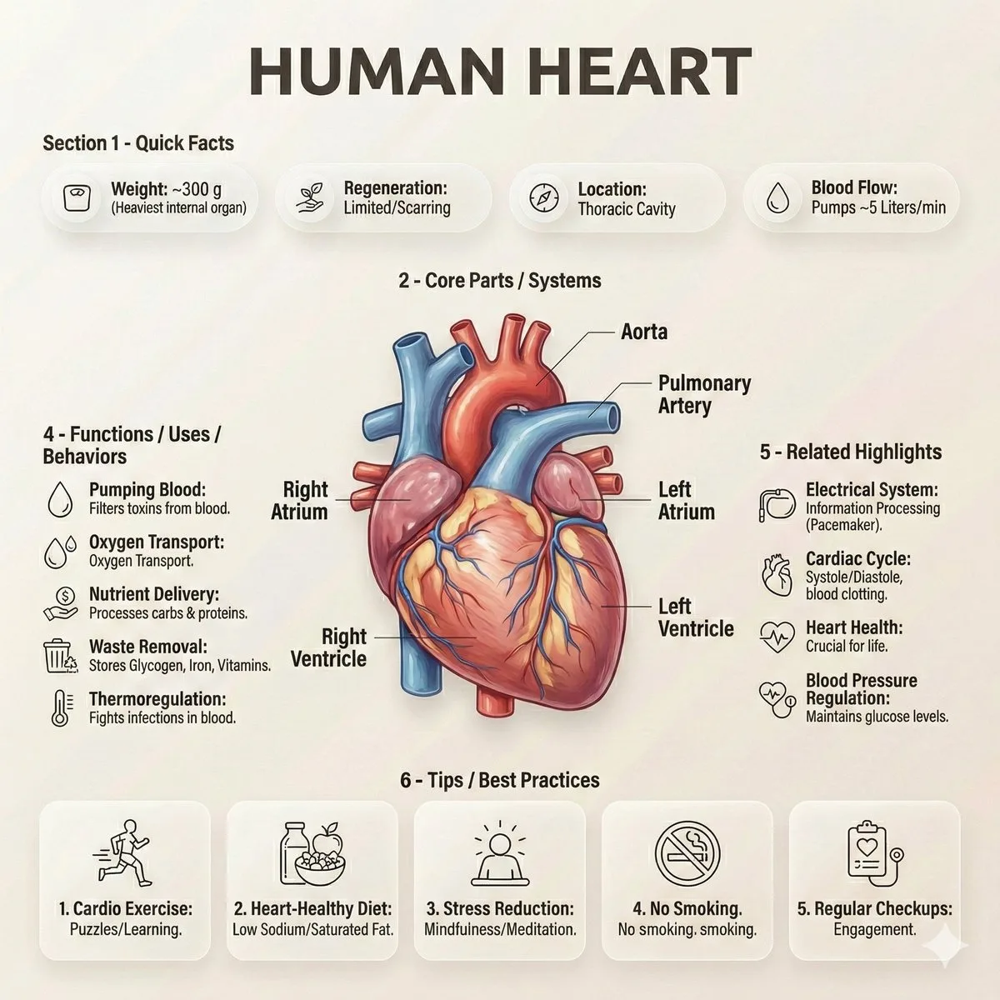

# 𝐌 — by @Strength04_X

[← Back to Community Examples](../../EXAMPLES.md) · Category: UI & Graphic · Model: `Nano Banana`

<a href="https://x.com/Strength04_X/status/2015630390887895118"></a>

Source: **[@Strength04_X on X](https://x.com/Strength04_X/status/2015630390887895118)** · Creator: [𝐌](https://x.com/Strength04_X)

## Prompt

```text
Ultra-clean modern editorial infographic poster (1080x1080), premium magazine layout meets lifestyle photography/illustration.

**TITLE:**
Large, bold sans-serif text at top center: "HUMAN LIVER"

**CENTRAL VISUAL:**
A realistic, high-fidelity 3D illustration of the Human Liver (showing Right/Left lobes and Gallbladder). Color palette: Terracotta, deep brownish-red, and soft coral, set against a clean soft beige/off-white background. Lighting is studio-soft.

**LAYOUT SECTIONS (Matching the reference):**

* **Section 1 - Quick Facts (Top Left/Right floating bubbles):**
    * "Weight: ~1.5 kg (Heaviest internal organ)"
    * "Regeneration: Can grow back from 25%"
    * "Location: Upper Right Abdomen"
    * "Blood Flow: Filters 1.4 Liters/min"

* **Section 2 - Core Parts / Systems (Labels pointing to central organ):**
    * Right Lobe
    * Left Lobe
    * Gallbladder (Greenish sac underneath)
    * Common Bile Duct
    * Hepatic Portal Vein

* **Section 4 - Functions / Uses (Left side list with minimal icons):**
    * **Detoxification:** Filters toxins from blood.
    * **Bile Production:** Digestion of fats.
    * **Metabolism:** Processes carbs & proteins.
    * **Storage:** Stores Glycogen, Iron, Vitamins.

* **Section 5 - Related Highlights (Right side list with minimal icons):**
    * **Chemical Factory:** Performs 500+ vital functions.
    * **Immune Defense:** Fights infections in blood.
    * **Clotting:** Produces proteins for blood clotting.

* **Section 6 - Tips / Best Practices (Bottom row, card style with icons):**
    1.  **Limit Alcohol:** Prevents cirrhosis/fatty liver.
    2.  **Hydration:** Water helps flush toxins.
    3.  **Balanced Diet:** Low sugar, high fiber.
    4.  **Vaccination:** Hepatitis A & B protection.
    5.  **Exercise:** Burn triglycerides/fat.

**STYLE:**
Glassmorphism effects on text boxes, soft drop shadows, medical accuracy mixed with high-end graphic design aesthetics.
```

## Try it

Paste the prompt into **[vinano.ai](https://vinano.ai?utm_source=github&utm_medium=readme&utm_campaign=awesome-image-video-prompts-updating&utm_content=x-page-try)** to generate your own version.

> The image and prompt belong to @Strength04_X ([original post](https://x.com/Strength04_X/status/2015630390887895118)) and are shown here with credit for reference. Creators can ask for changes or removal by opening an issue.
