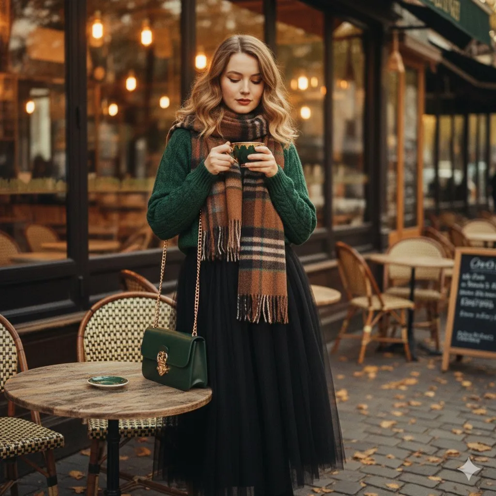

# Aarvi sharma — by @me_Aarvi

[← Back to Examples from X](../../EXAMPLES.md) · Category: Photography · Model: `Nano Banana`

<a href="https://x.com/me_Aarvi/status/2008687707946709129"></a>

Original post: **[@me_Aarvi on X](https://x.com/me_Aarvi/status/2008687707946709129)** · Creator: [Aarvi sharma](https://x.com/me_Aarvi)

## Prompt

```text
A cinematic 1970s-inspired fashion portrait of a graceful young woman seated on worn stone steps outside a cozy street café. She holds an ornate deep-green ceramic coffee cup with delicate gold rim accents, gently resting it in her hands as she gazes softly toward the camera with calm confidence. Her expression feels serene, thoughtful, and timeless.
Her hair falls in soft, natural waves with loose strands framing her face, styled in a classic vintage manner. Makeup reflects 1970s elegance: matte crimson-red lips, subtle winged eyeliner, warm-toned blush, and softly defined brows. She wears a luxurious forest-green knitted sweater with a relaxed fit, paired with a flowing black tulle skirt that moves lightly with the air.
A warm plaid scarf in earthy browns, burnt orange, and muted reds is draped casually around her neck. Beside her rests a premium dark-green leather crossbody bag with gold filigree hardware and a delicate chain strap.
The background features an autumn café street with scattered fallen leaves, glowing amber lights behind glass windows, and a soft urban stillness. Shot with an 85mm lens at f/1.8, shallow depth of field, warm analog film grain, muted earthy palette, dreamy cinematic mood, ultra-realistic fashion editorial photography inspired by classic 1970s film aesthetics.
```

## Try it

Paste the prompt into **[vinano.ai](https://vinano.ai?utm_source=github&utm_medium=readme&utm_campaign=awesome-image-video-prompts-updating&utm_content=x-page-try)** to generate your own version.

> The image and prompt belong to [@me_Aarvi](https://x.com/me_Aarvi) and are shown here with credit for reference. Creators can ask for changes or removal by opening an issue.
