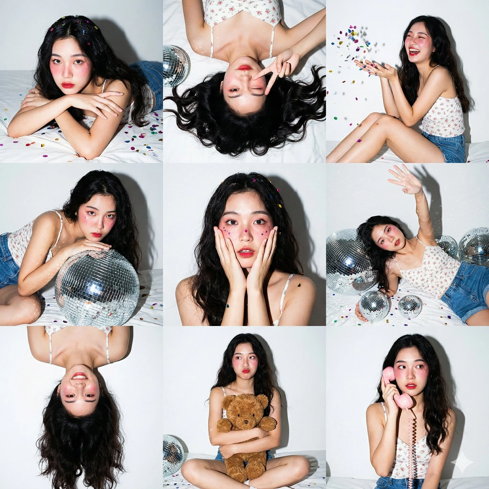

# Iqra Saifi — by @IqraSaifiii

[← Back to Examples from X](../../EXAMPLES.md) · Category: Photography · Model: `Nano Banana`

<a href="https://x.com/IqraSaifiii/status/2010083845761314964"></a>

Original post: **[@IqraSaifiii on X](https://x.com/IqraSaifiii/status/2010083845761314964)** · Creator: [Iqra Saifi](https://x.com/IqraSaifiii)

## Prompt

```text
3x3 Photo Collage / 9-Panel Grid.",
      "layout": "Nine vertical portrait images arranged in a square grid.",
      "consistency": "Same subject, same outfit, and same lighting across all 9 panels."
    },
    "aesthetic_style": {
      "theme": "Gen Z Home Party / 'Maiden Pavilion' Photoshoot.",
      "lighting_technique": "Direct On-Camera Flash (Hard Light).",
      "visuals": "High contrast, sharp shadows, chaotic fun, vibrant colors against a white background."
    },
    "subject_details": {
      "appearance": "Young Asian woman, fair skin, long dark wavy hair with volume.",
      "outfit": "White floral camisole top, blue denim shorts.",
      "makeup": "Heavy pink blush (Igari style), red lips, glitter on cheeks."
    },
    "environment_and_props": {
      "background": "White wall with taped photos, white bed sheets.",
      "decor": "Silver disco balls (various sizes), colorful metallic confetti scattered everywhere, brown teddy bear, pink retro corded phone."
    },
    "panel_pose_breakdown": {
      "1_top_left": "Lying on stomach (prone), resting chin on crossed arms, looking at camera. Confetti in hair.",
      "2_top_center": "Top-down view lying on back, winking one eye, making a peace sign near face. Hair fanned out.",
      "3_top_right": "Sitting sideways, knees bent, laughing candidly while throwing a handful of confetti in the air.",
      "4_middle_left": "Leaning upper body over a large silver disco ball, looking intensely at the camera.",
      "5_middle_center": "Close-up portrait. Hands touching cheeks in a 'surprised' or 'shy' gesture. Confetti stuck to cheeks.",
      "6_middle_right": "Lying on back amongst the disco balls, one arm reaching up towards the ceiling/camera.",
      "7_bottom_left": "Upside-down perspective (head at bottom of frame), playful expression, hair cascading down.",
      "8_bottom_center": "Sitting cross-legged (Lotus position), hugging the brown teddy bear tight, pouting slightly.",
      "9_bottom_right": "Sitting up, holding the pink retro telephone receiver to ear, looking sideways as if listening to gossip."
    },
    "camera_technical_values": {
      "focal_length": "35mm (Versatile environmental portrait lens).",
      "aperture": "f/5.6 (Ensures subject and props are in focus).",
      "shutter_speed": "1/200s (Flash sync to freeze confetti motion).",
      "iso": "ISO 200.",
      "lighting": "Hard flash creates a distinct drop shadow behind the subject on the white wall and specular highlights on the disco balls."
    }
  },
  "midjourney_string": "3x3 photo grid collage of a cute Asian girl at a home party, wearing white floral top and
```

## Try it

Paste the prompt into **[vinano.ai](https://vinano.ai?utm_source=github&utm_medium=readme&utm_campaign=awesome-image-video-prompts-updating&utm_content=x-page-try)** to generate your own version.

> The image and prompt belong to [@IqraSaifiii](https://x.com/IqraSaifiii) and are shown here with credit for reference. Creators can ask for changes or removal by opening an issue.
