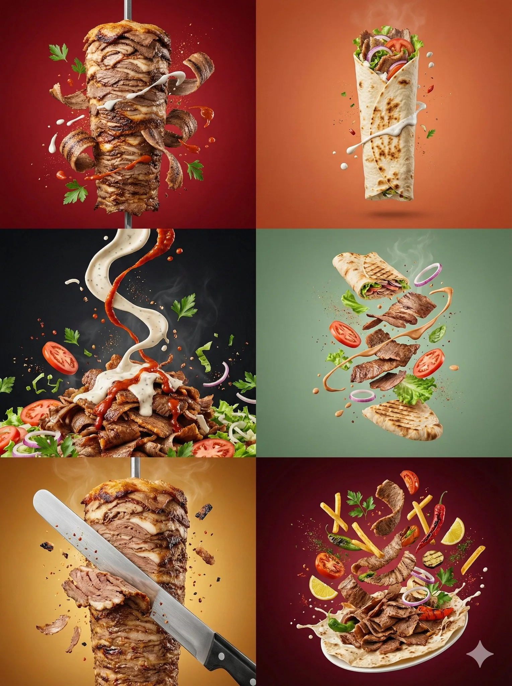

# Kaan — by @kaanakz

[← Back to Community Examples](../../EXAMPLES.md) · Category: Food & Drink · Model: `Nano Banana`

<a href="https://x.com/kaanakz/status/2009941784965853278"></a>

Source: **[@kaanakz on X](https://x.com/kaanakz/status/2009941784965853278)** · Creator: [Kaan](https://x.com/kaanakz)

## Prompt

```text
{
  "resolution": "8K UHD",
  "aspect_ratio": "3:4",
  "image_style": "hyper-realistic commercial food photography",
  "global_settings": {
    "quality": "Ultra-high detail, razor-sharp focus, premium street food clarity",
    "lighting": "Controlled studio lighting emphasizing meat texture, char marks, and sauce glistening",
    "motion": "Frozen mid-air elements with subtle gravity realism",
    "background_style": "Solid or smooth gradient background, color varies per module",
    "camera": "High-speed photography look, shallow to medium depth of field",
    "post_processing": "Rich contrast, warm savory tones, natural shine, appetizing color grading"
  },
  "modules": {
    
    "module_1_classic_doner_slice_explosion": {
      "scene_description": "A dramatic vertical döner stack with flying meat slices and sauce droplets",
      "doner": {
        "type": "Traditional Turkish döner kebab slices",
        "texture": "Thinly sliced beef and lamb mix with visible char marks",
        "cut": "Paper-thin ribbons",
        "position": "Stacked vertically and floating mid-air"
      },
      "details": {
        "char_marks": "Dark caramelized edges with grill stripes",
        "fat_marbling": "Glistening fat streaks between meat layers",
        "seasoning": "Visible spice particles on meat surface"
      },
      "motion_effects": {
        "meat_slices": "Individual döner slices spiraling outward",
        "sauce": "White garlic sauce and red chili sauce droplets splashing",
        "herbs": "Fresh parsley leaves floating in air"
      },
      "background": {
        "color": "Deep crimson red",
        "texture": "Smooth, seamless"
      }
    },

    "module_2_minimal_doner_durum_floating": {
      "scene_description": "Minimalist premium döner dürüm presentation with controlled floating ingredients",
      "doner": {
        "type": "Perfectly wrapped dürüm (wrap) cross-section",
        "arrangement": "Single dürüm cut in half, floating vertically",
        "surface": "Lightly toasted lavash bread with golden char marks"
      },
      "accent_elements": {
        "filling": "Layered döner meat, lettuce, tomatoes, onions visible in cross-section",
        "sauce": "White garlic yogurt sauce drizzling elegantly",
        "vegetables": "Fresh red tomato slices, crisp lettuce, purple onion rings"
      },
      "motion_effects": {
        "particles": "Subtle floating spice particles and herb fragments",
        "drops": "Sauce droplets frozen mid-fall"
      },
      "background": {
        "color": "Warm terracotta orange",
        "gradient": "Very soft tonal gradient"
      }
    },

    "module_3_doner_sauce_pour_drama": {
      "scene_description": "Cinematic sauce pour over döner meat pile",
      "doner": {
        "type": "Mountain of freshly sliced döner meat",
        "texture": "Highly detailed crispy edges and tender interior"
      },
      "additional_elements": {
        "sauces": {
          "white_sauce": {
            "state": "Thick creamy garlic yogurt sauce pouring from above",
            "motion": "Frozen in elegant flowing ribbon"
          },
          "red_sauce": {
            "state": "Spicy red chili sauce drizzling alongside",
            "motion": "Thin crimson streams intertwining with white sauce"
          }
        },
        "vegetables": [
          "Sliced tomatoes",
          "Chopped lettuce",
          "Thinly sliced onions",
          "Fresh parsley sprigs"
        ]
      },
      "motion_effects": {
        "splashes": "Micro sauce splashes on meat surface",
        "particles": "Floating spice particles and herb fragments",
        "steam": "Subtle heat vapor rising from meat"
      },
      "background": {
        "color": "Dark charcoal black",
        "tone": "High contrast, premium street food aesthetic"
      }
    },

    "module_4_modern_doner_deconstructed_composition": {
      "scene_description": "Modern deconstructed döner composition in mid-air",
      "elements": {
        "bread": "Pieces of toasted lavash bread floating separately",
        "meat": "Individual döner slices suspended at different angles",
        "vegetables": "Tomato slices, lettuce leaves, onion rings floating between layers",
        "sauces": "Glossy sauce ribbons connecting elements artistically"
      },
      "motion_effects": {
        "particles": "Ultra-fine spice dust suspended in air",
        "drops": "Scattered sauce droplets frozen in motion",
        "steam": "Minimal heat waves rising from meat"
      },
      "background": {
        "color": "Muted sage green",
        "texture": "Smooth, seamless"
      }
    },

    "module_5_rotating_doner_spit_close_up": {
      "scene_description": "Extreme close-up of döner meat on vertical spit with knife slice frozen in time",
      "doner_spit": {
        "type": "Vertical döner tower on rotating spit",
        "texture": "Layers of seasoned meat with charred outer crust",
        "detail": "Visible spices, fat marbling, and grill marks"
      },
      "action_elements": {
        "knife": "Large döner knife mid-slice through meat",
        "meat_slice": "Fresh slice falling away from spit",
        "shavings": "Meat shavings and crispy bits floating"
      },
      "motion_effects": {
        "particles": "Charred bits and seasoning particles in air",
        "steam": "Heat vapor wisps rising from fresh cut"
      },
      "background": {
        "color": "Rich golden amber",
        "texture": "Smooth gradient"
      }
    },

    "module_6_doner_plate_overhead_explosion": {
      "scene_description": "Overhead shot of döner plate with ingredients exploding upward",
      "composition": {
        "base": "Thin lavash bread pieces on bottom",
        "center": "Pile of döner meat slices",
        "explosion": "All ingredients bursting upward in circular pattern"
      },
      "flying_elements": [
        "Döner meat slices spiraling",
        "French fries launching upward",
        "Grilled peppers and tomatoes",
        "Fresh parsley and sumac",
        "Sauce droplets spraying",
        "Lemon wedges"
      ],
      "motion_effects": {
        "height_variation": "Elements at different heights creating depth",
        "rotation": "Some elements rotating while airborne"
      },
      "background": {
        "color": "Deep burgundy red",
        "style": "Vignette effect focusing on center"
      }
    }

  },
  "negative_prompt": [
    "text",
    "logos",
    "branding",
    "hands",
    "people",
    "utensils beyond döner knife",
    "full plates visible",
    "tables",
    "restaurant interior",
    "cartoon style",
    "raw meat",
    "excessive grease pooling",
    "burnt or overcooked appearance",
    "overexposure",
    "artificial glow",
    "low detail textures",
    "unappetizing colors",
    "plastic-looking food"
  ]
}
```

## Try it

Paste the prompt into **[vinano.ai](https://vinano.ai?utm_source=github&utm_medium=readme&utm_campaign=awesome-image-video-prompts-updating&utm_content=x-page-try)** to generate your own version.

> The image and prompt belong to @kaanakz ([original post](https://x.com/kaanakz/status/2009941784965853278)) and are shown here with credit for reference. Creators can ask for changes or removal by opening an issue.
