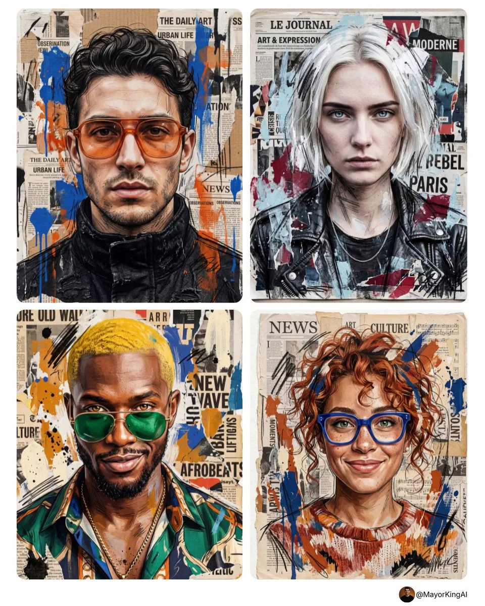

# MayorkingAI — by @MayorKingAI

[← Back to Community Examples](../../EXAMPLES.md) · Category: Poster Design · Model: `Nano Banana`

<a href="https://x.com/MayorKingAI/status/2036534946433736932"></a>

Source: **[@MayorKingAI on X](https://x.com/MayorKingAI/status/2036534946433736932)** · Creator: [MayorkingAI](https://x.com/MayorKingAI)

## Prompt

```text
Mixed-media portrait of [SUBJECT], [EXPRESSION], [GAZE DIRECTION], with [ACCESSORY/STYLING], realistic identity, black sketch strokes, torn newspaper collage, acrylic paint splashes, editorial print texture, blending realism and abstract expressionism, premium poster aesthetic, tactile handmade feel, high contrast, ultra-detailed face and eyes, [PRIMARY COLORS] and [SECONDARY COLORS]
```

## Try it

Paste the prompt into **[vinano.ai](https://vinano.ai?utm_source=github&utm_medium=readme&utm_campaign=awesome-image-video-prompts-updating&utm_content=x-page-try)** to generate your own version.

> The image and prompt belong to @MayorKingAI ([original post](https://x.com/MayorKingAI/status/2036534946433736932)) and are shown here with credit for reference. Creators can ask for changes or removal by opening an issue.
