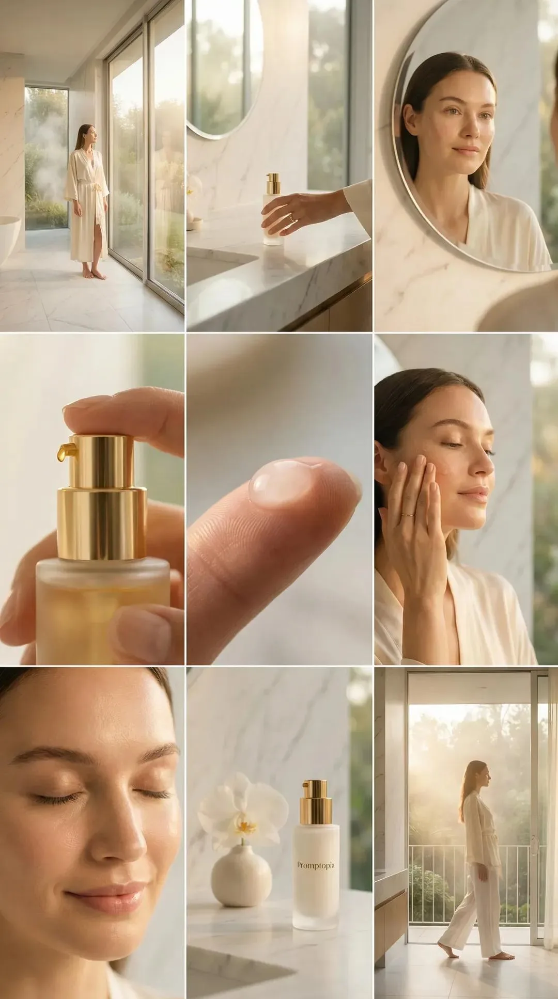

# Oogie — by @oggii_0

[← Back to Community Examples](../../EXAMPLES.md) · Category: Product & Brand · Model: `Nano Banana`

<a href="https://x.com/oggii_0/status/2009580453083201822"></a>

Source: **[@oggii_0 on X](https://x.com/oggii_0/status/2009580453083201822)** · Creator: [Oogie](https://x.com/oggii_0)

## Prompt

```text
{
  "subject": {
    "person": "Woman, appears to be in her 20s or 30s",
    "pose_and_expression": [
      "Standing by window, looking out, relaxed",
      "Reaching for bottle on counter, hand focus",
      "Looking in mirror, slight smile",
      "Hand dispensing serum from bottle, close-up",
      "Serum drop on fingertip, macro shot",
      "Applying serum to face, eyes closed, serene",
      "Face close-up, eyes closed, content",
      "Bottle and orchid on counter, still life",
      "Walking away from camera, standing by window"
    ]
  },
  "clothing": {
    "items": "White robe, white pajamas/loungewear",
    "material": "Soft, flowing fabric",
    "style": "Casual, luxurious"
  },
  "hair": {
    "color": "Dark brown",
    "style": "Pulled back, neat bun or ponytail"
  },
  "face": {
    "makeup": "Natural, minimal",
    "skin": "Clear, glowing",
    "expression": "Calm, serene, content"
  },
  "accessories": {
    "jewelry": "Simple ring on ring finger",
    "props": [
      "Glass skincare bottle with gold pump dispenser",
      "Product label: 'Promptopia'",
      "White orchid in a small white vase"
    ]
  },
  "environment": {
    "location": "Modern, luxurious bathroom",
    "elements": [
      "Large floor-to-ceiling windows",
      "Marble countertop and walls",
      "Round mirror",
      "View of trees/garden outside",
      "Fog or mist outside window"
    ],
    "atmosphere": "Serene, spa-like, tranquil"
  },
  "lighting": {
    "source": "Natural daylight",
    "quality": "Warm, golden, soft, diffused",
    "time_of_day": "Sunrise or golden hour"
  },
  "camera": {
    "type": "Photography collage",
    "shots": [
      "Wide shot",
      "Medium shot",
      "Close-up",
      "Macro shot"
    ],
    "focus": "Sharp on subject and product, soft background blur (bokeh)"
  },
  "style": {
    "aesthetic": "Cinematic, editorial, beauty, wellness, clean, minimalist",
    "color_palette": "Warm neutrals, white, gold, natural greens"
  }
}
```

## Try it

Paste the prompt into **[vinano.ai](https://vinano.ai?utm_source=github&utm_medium=readme&utm_campaign=awesome-image-video-prompts-updating&utm_content=x-page-try)** to generate your own version.

> The image and prompt belong to @oggii_0 ([original post](https://x.com/oggii_0/status/2009580453083201822)) and are shown here with credit for reference. Creators can ask for changes or removal by opening an issue.
