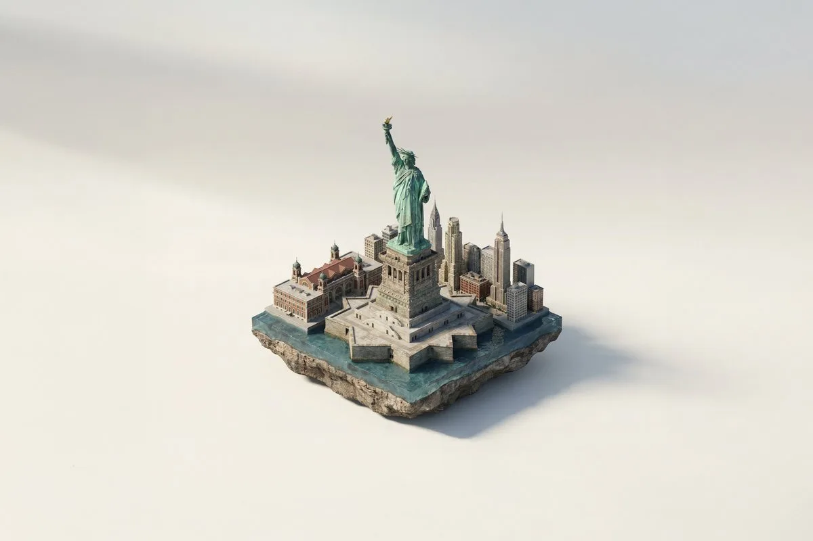

# Ege — by @egeberkina

[← Back to Examples from X](../../EXAMPLES.md) · Category: Illustration & 3D · Model: `Nano Banana`

<a href="https://x.com/egeberkina/status/2011378770494566596"></a>

Original post: **[@egeberkina on X](https://x.com/egeberkina/status/2011378770494566596)** · Creator: [Ege](https://x.com/egeberkina)

## Prompt

```text
A miniature isometric architectural diorama of [LANDMARK NAME], accurately reflecting its real-world structure and proportions, placed on a small floating base with subtle surrounding buildings and landscape elements inspired by [CITY / COUNTRY]. Realistic materials and natural textures, physically accurate stone, concrete, metal, and glass surfaces. True-to-life color palette based on the actual landmark, muted and realistic tones. Off-white studio background with soft, natural lighting, gentle shadows, and clean composition. High-detail, realistic yet refined 3D render, premium architectural model aesthetic, no people, no text.
```

## Try it

Paste the prompt into **[vinano.ai](https://vinano.ai?utm_source=github&utm_medium=readme&utm_campaign=awesome-image-video-prompts-updating&utm_content=x-page-try)** to generate your own version.

> The image and prompt belong to [@egeberkina](https://x.com/egeberkina) and are shown here with credit for reference. Creators can ask for changes or removal by opening an issue.
