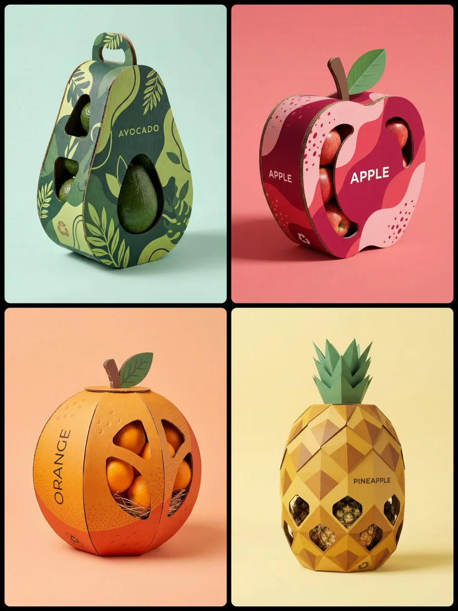

# ΛRMIN | AI — by @Arminn_Ai

[← Back to Examples from X](../../EXAMPLES.md) · Category: Product & Brand · Model: `Nano Banana`

<a href="https://x.com/Arminn_Ai/status/2022199501168038032"></a>

Original post: **[@Arminn_Ai on X](https://x.com/Arminn_Ai/status/2022199501168038032)** · Creator: [ΛRMIN | AI](https://x.com/Arminn_Ai)

## Prompt

```text
A high-quality professional product photography of a creative structural packaging design for [Fruit Name]. The packaging is made of premium corrugated cardboard, intricately crafted into the literal shape of a giant stylized [Shape e.g. spherical, curved, elongated] [Fruit Name].

The exterior surface features a vibrant and sophisticated printed pattern of minimalist [Pattern Description e.g. geometric hexagons, organic wavy lines, dotted stippling, botanical line-art, or horizontal ridges], mimicking the Natural Skin of the Fruit in a duo-tone palette of [Color 1] and [Color 2].

Features clever die-cut windows that reveal the actual [Actual Product Inside] stored inside. Minimalist modern typography on the side saying "[NAME]". Includes eco-friendly details like a small recycling logo and a [3D Corrugated Cardboard Detail: Stem/green Leaf/Crown] on top. Soft studio lighting with gentle shadows, placed on a clean solid pastel [Background Color] background. 8k resolution, photorealistic, cinematic composition, industrial design aesthetic.
```

## Try it

Paste the prompt into **[vinano.ai](https://vinano.ai?utm_source=github&utm_medium=readme&utm_campaign=awesome-image-video-prompts-updating&utm_content=x-page-try)** to generate your own version.

> The image and prompt belong to [@Arminn_Ai](https://x.com/Arminn_Ai) and are shown here with credit for reference. Creators can ask for changes or removal by opening an issue.
