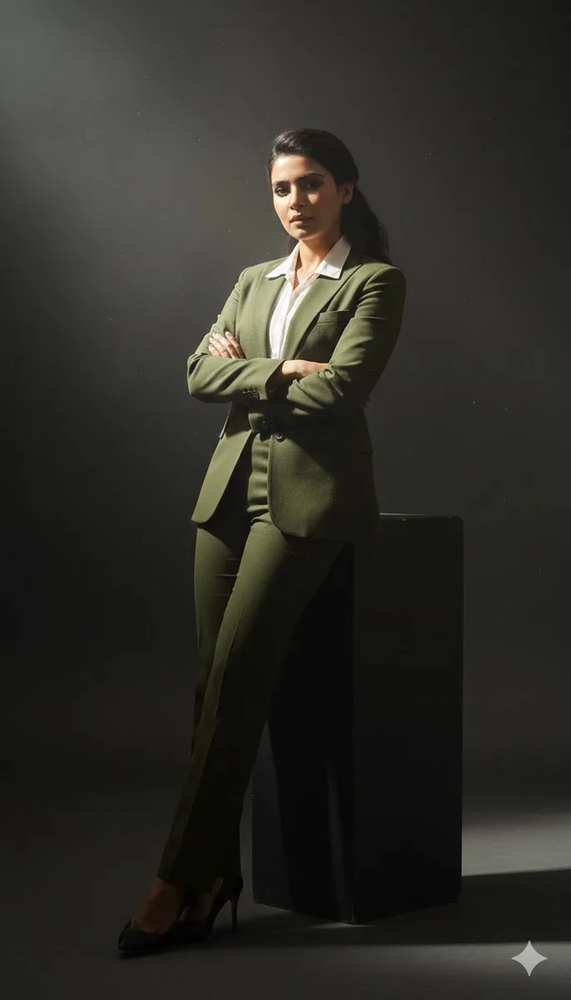

# ராஜேஷ் — by @r4jjesh

[← Back to Examples from X](../../EXAMPLES.md) · Category: Photography · Model: `Nano Banana`

<a href="https://x.com/r4jjesh/status/2020480621026705858"></a>

Original post: **[@r4jjesh on X](https://x.com/r4jjesh/status/2020480621026705858)** · Creator: [ராஜேஷ்](https://x.com/r4jjesh)

## Prompt

```text
{
  "prompt": "Cinematic full-body studio portrait of a subject using the uploaded face as exact reference (preserve identity, facial structure, and proportions). Slightly low-angle perspective with a 35mm lens for a commanding, sophisticated presence. Subject leaning casually against a dark minimalist plinth, arms crossed. Wearing a perfectly tailored slim-fit olive green suit and a crisp white dress shirt, top buttons undone. Intense chiaroscuro lighting with a single powerful volumetric spotlight from the upper-left, cutting through subtle atmospheric haze with swirling smoke and micro-dust particles. Sharp rim highlights along shoulders and silhouette, deep velvety shadows across the body, high-contrast moody aesthetic. Hyper-realistic textures, visible fabric weave, subtle reflections on a polished studio floor, professional cinematic lighting, ultra-detailed, 8K resolution, no text, no watermark.",
  "resolution": "7680x4320",
  "camera": {
    "lens": "35mm",
    "angle": "slightly low-angle",
    "aperture": "f/2.0",
    "iso": "100",
    "shutter_speed": "1/125"
  },
  "quality": "ultra-high",
  "style": "cinematic, hyper-realistic, studio photography",
  "negative_prompt": "blurry, low-resolution, overexposed, underexposed, flat lighting, cartoon, CGI, plastic skin, extra limbs, distorted hands, bad anatomy, asymmetry, watermark, logo, text"
}
```

## Try it

Paste the prompt into **[vinano.ai](https://vinano.ai?utm_source=github&utm_medium=readme&utm_campaign=awesome-image-video-prompts-updating&utm_content=x-page-try)** to generate your own version.

> The image and prompt belong to [@r4jjesh](https://x.com/r4jjesh) and are shown here with credit for reference. Creators can ask for changes or removal by opening an issue.
