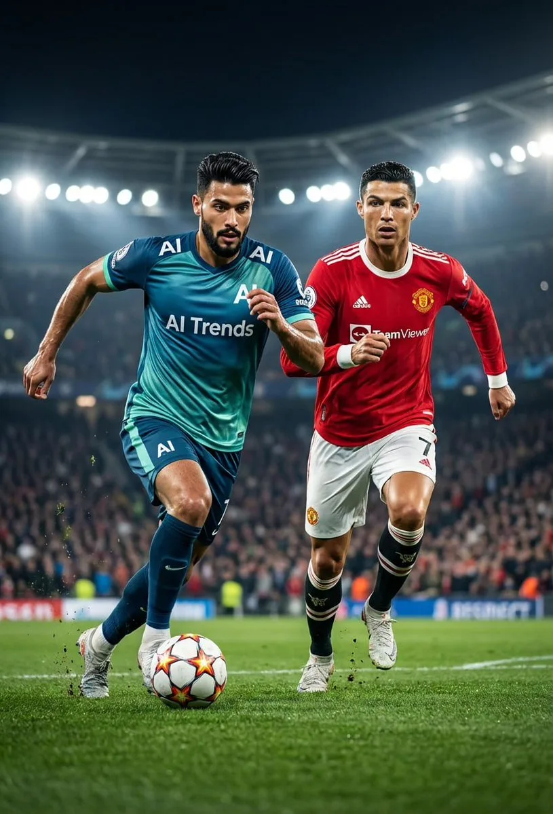

# Abhishek Singh — by @2abhisheknaks

[← Back to Community Examples](../../EXAMPLES.md) · Category: Photography · Model: `Nano Banana`

<a href="https://x.com/2abhisheknaks/status/2013550317347193242"></a>

Source: **[@2abhisheknaks on X](https://x.com/2abhisheknaks/status/2013550317347193242)** · Creator: [Abhishek Singh](https://x.com/2abhisheknaks)

## Prompt

```text
{
A hyper-realistic, ultra-detailed 8K cinematic wide-shot of a football scene, captured from a dramatic low-angle perspective with a wide-angle lens and shallow depth of field, emphasizing speed, power, and realism.

The scene features only two players on a professional football pitch.
The primary player, positioned slightly ahead and in control of the ball, is dribbling with explosive movement and confident body language. His face is generated using the uploaded face as reference (100% likeness).

He wears an ultra-realistic AI Trends football kit, designed like a top-tier international club jersey. The kit has a blue-green gradient finish, breathable performance fabric, and subtle geometric textures. “AI Trends” branding is printed boldly on the chest and both shoulders in premium sports typography. The fabric reacts naturally to motion, showing realistic folds, tension, and subtle sweat details, giving a luxury global campaign aesthetic.

Running beside him is Cristiano Ronaldo, wearing his iconic classic football kit, instantly recognizable by its design, colors, and number. Cristiano is not holding the ball. He matches pace powerfully, positioned slightly to the side, ready for a decisive run or finish.

No other players are on the field.

The grass pitch is extremely detailed, with visible blades, dirt particles, and subtle turf displacement beneath their feet. Water droplets and dust rise with each step, enhancing motion realism.
The background features a massive stadium with a softly blurred crowd, cinematic depth, and powerful volumetric lighting creating dramatic rim light around both players. Subtle motion blur enhances speed while both faces remain sharp and detailed.
The mood is powerful and cinematic, resembling a high-budget sports film still and a premium AI Trends global campaign, with natural color grading, hyper-realistic textures, and professional sports photography aesthetics.
```

## Try it

Paste the prompt into **[vinano.ai](https://vinano.ai?utm_source=github&utm_medium=readme&utm_campaign=awesome-image-video-prompts-updating&utm_content=x-page-try)** to generate your own version.

> The image and prompt belong to @2abhisheknaks ([original post](https://x.com/2abhisheknaks/status/2013550317347193242)) and are shown here with credit for reference. Creators can ask for changes or removal by opening an issue.
