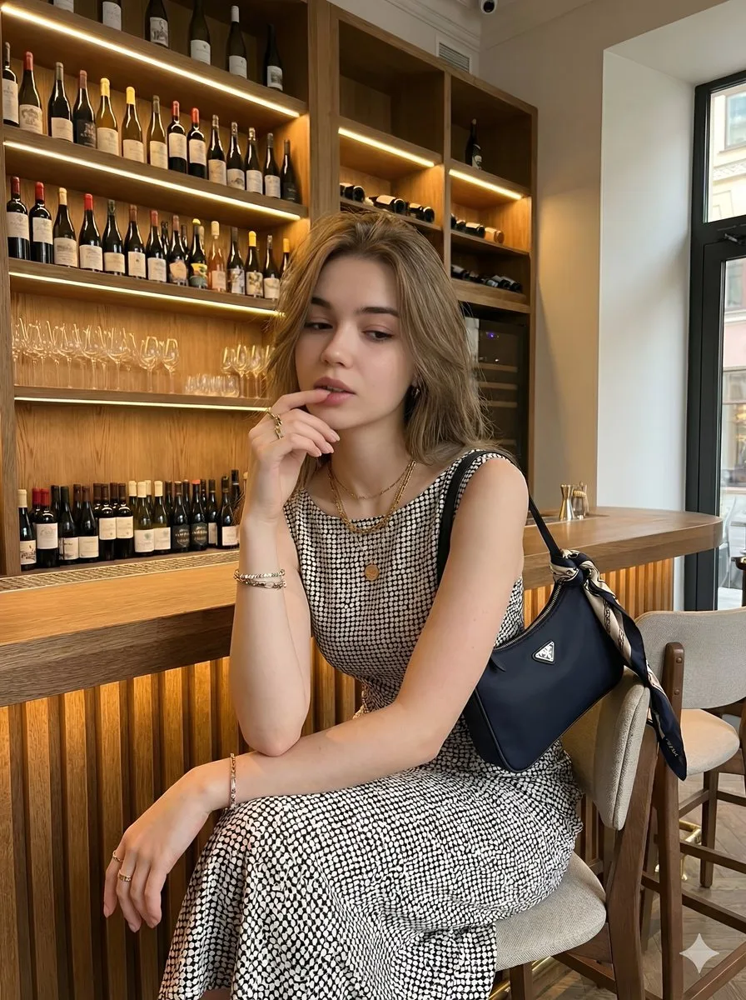

# Abhishek Singh — by @2abhisheknaks

[← Back to Community Examples](../../EXAMPLES.md) · Category: Photography · Model: `Nano Banana`

<a href="https://x.com/2abhisheknaks/status/2011378277001363610"></a>

Source: **[@2abhisheknaks on X](https://x.com/2abhisheknaks/status/2011378277001363610)** · Creator: [Abhishek Singh](https://x.com/2abhisheknaks)

## Prompt

```text
Young beautiful woman with long wavy hair, elegant sleeveless polka dot midi dress black and white pattern, sitting thoughtfully at stylish wine bar counter, hand near lips, luxury wine bottles wall background, Prada navy blue mini bag with silk scarf, gold jewelry, sophisticated chic atmosphere, soft warm lighting, cinematic, highly detailed, realistic

Use my uploaded face image as the ONLY facial and identity reference. No other faces, models, datasets, or references are allowed.
```

## Try it

Paste the prompt into **[vinano.ai](https://vinano.ai?utm_source=github&utm_medium=readme&utm_campaign=awesome-image-video-prompts-updating&utm_content=x-page-try)** to generate your own version.

> The image and prompt belong to @2abhisheknaks ([original post](https://x.com/2abhisheknaks/status/2011378277001363610)) and are shown here with credit for reference. Creators can ask for changes or removal by opening an issue.
