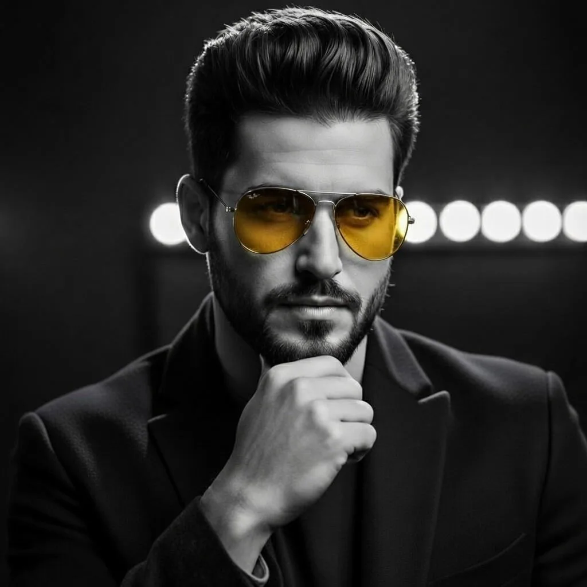

# Abhishek Singh — by @2abhisheknaks

[← Back to Community Examples](../../EXAMPLES.md) · Category: Photography · Model: `Nano Banana`

<a href="https://x.com/2abhisheknaks/status/2012888202760384949"></a>

Source: **[@2abhisheknaks on X](https://x.com/2abhisheknaks/status/2012888202760384949)** · Creator: [Abhishek Singh](https://x.com/2abhisheknaks)

## Prompt

```text
{
  "objective": "Create a dramatic, high-contrast cinematic portrait of a stylish young man in a premium black suit with selective warm lighting and intense mood",
  "subject": {
    "type": "Young adult male",
    "age_appearance": "25-30",
    "hair": "Black, voluminous, slicked back pompadour style, perfectly styled with high shine",
    "facial_hair": "Well-groomed short boxed beard and mustache",
    "expression": "Intense, confident, serious, slightly mysterious",
    "pose": "Hand under chin thoughtful/contemplative pose, looking directly at camera",
    "accessories": {
      "sunglasses": "Classic aviator style, gold metal frame, strong yellow/orange tinted lenses",
      "clothing": {
        "outerwear": "Premium matte black tailored blazer/jacket, sharp lapels, high-end luxurious fabric texture",
        "innerwear": "Dark charcoal or black crew-neck t-shirt"
      }
    }
  },
  "lighting": {
    "style": "Cinematic studio lighting",
    "main": "Strong side and rim lighting creating deep shadows and dramatic highlights",
    "background": "Dark gradient with circular warm spotlight array (vanity/makeup studio lights)",
    "contrast": "Very high contrast, deep blacks, bright highlights on face and hair",
    "mood": "Moody, masculine, powerful, film-noir inspired"
  },
  "composition": {
    "framing": "Tight mid-close-up portrait, head and shoulders",
    "angle": "Slightly below eye level for commanding presence",
    "depth_of_field": "Shallow, sharp focus on face and sunglasses, soft background"
  },
  "color_palette": {
    "dominant": "Black & deep charcoal",
    "accents": "Warm yellow-orange from sunglasses lenses and background lights",
    "skin_tone": "Natural with subtle cinematic glow"
  },
  "style_references": [
    "Modern film-noir",
    "High-end fashion editorial",
    "Hollywood dramatic portrait",
    "David LaChapelle meets classic menswear advertising"
  ],
  "image_quality": {
    "resolution": "Ultra-high detail, 8K",
    "sharpness": "Crisp facial features, hair strands visible",
    "texture": "Detailed skin pores, fabric weave, hair shine"
  },
  "negative_prompt": [
    "low quality",
    "blurry",
    "overexposed",
    "underexposed",
    "cartoon",
    "anime",
    "distorted face",
    "extra limbs",
    "bad anatomy",
    "logo",
    "text",
    "watermark",
    "bright colored clothing",
    "casual outfit"
  ],
  "aspect_ratio": "2:3 (portrait orientation)"
}
```

## Try it

Paste the prompt into **[vinano.ai](https://vinano.ai?utm_source=github&utm_medium=readme&utm_campaign=awesome-image-video-prompts-updating&utm_content=x-page-try)** to generate your own version.

> The image and prompt belong to @2abhisheknaks ([original post](https://x.com/2abhisheknaks/status/2012888202760384949)) and are shown here with credit for reference. Creators can ask for changes or removal by opening an issue.
