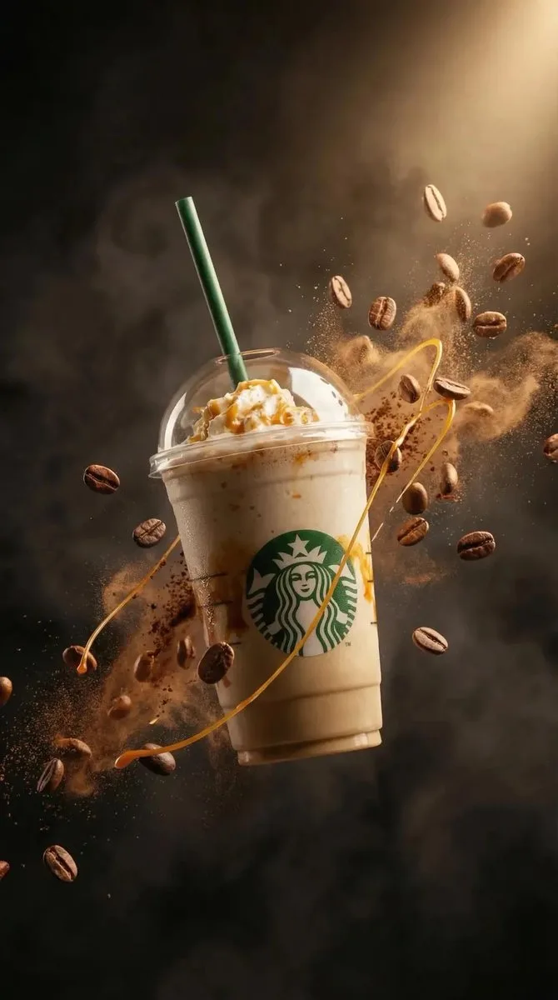

# Kashberg — by @Kashberg_0

[← Back to Community Examples](../../EXAMPLES.md) · Category: Food & Drink · Model: `Nano Banana`

<a href="https://x.com/Kashberg_0/status/2024707382727889320"></a>

Source: **[@Kashberg_0 on X](https://x.com/Kashberg_0/status/2024707382727889320)** · Creator: [Kashberg](https://x.com/Kashberg_0)

## Prompt

```text
Ultra-realistic commercial product photography of a caramel frappuccino in a clear plastic cup with dome lid and green straw, topped with whipped cream and caramel drizzle, floating mid-air. Coffee beans exploding around the cup with fine coffee powder dust particles suspended in the air, dynamic caramel splash trails swirling around the drink. Dark smoky background with dramatic spotlight from above, warm golden rim lighting, high contrast, sharp focus, macro details, cinematic depth of field, hyper-detailed texture, premium beverage advertisement, 8K resolution.
```

## Try it

Paste the prompt into **[vinano.ai](https://vinano.ai?utm_source=github&utm_medium=readme&utm_campaign=awesome-image-video-prompts-updating&utm_content=x-page-try)** to generate your own version.

> The image and prompt belong to @Kashberg_0 ([original post](https://x.com/Kashberg_0/status/2024707382727889320)) and are shown here with credit for reference. Creators can ask for changes or removal by opening an issue.
