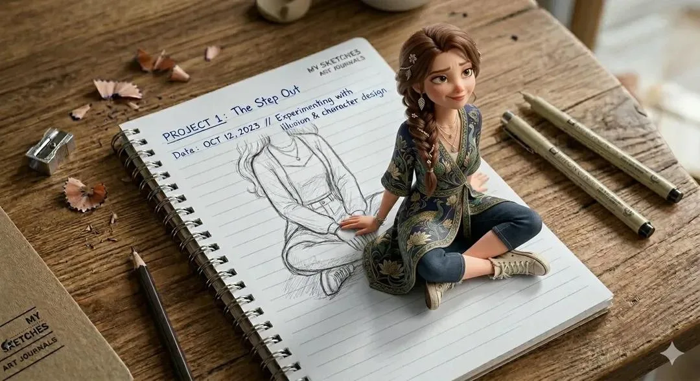

# Oogie — by @oggii_0

[← Back to Examples from X](../../EXAMPLES.md) · Category: Illustration & 3D · Model: `Nano Banana`

<a href="https://x.com/oggii_0/status/2028389324677611935"></a>

Original post: **[@oggii_0 on X](https://x.com/oggii_0/status/2028389324677611935)** · Creator: [Oogie](https://x.com/oggii_0)

## Prompt

```text
A creative 3D illusion artwork of a cute young girl stepping out of a spiral notebook page placed on a wooden desk. The notebook has lined paper with handwritten text at the top. The girl looks semi-realistic 3D cartoon style, soft wavy brown hair, natural makeup, sweet smile, wearing a pastel crop top and high-waisted light grey jeans with white sneakers. Her lower body appears sketched in pencil on the notebook while the upper body looks realistic and popping out of the page.
```

## Try it

Paste the prompt into **[vinano.ai](https://vinano.ai?utm_source=github&utm_medium=readme&utm_campaign=awesome-image-video-prompts-updating&utm_content=x-page-try)** to generate your own version.

> The image and prompt belong to [@oggii_0](https://x.com/oggii_0) and are shown here with credit for reference. Creators can ask for changes or removal by opening an issue.
