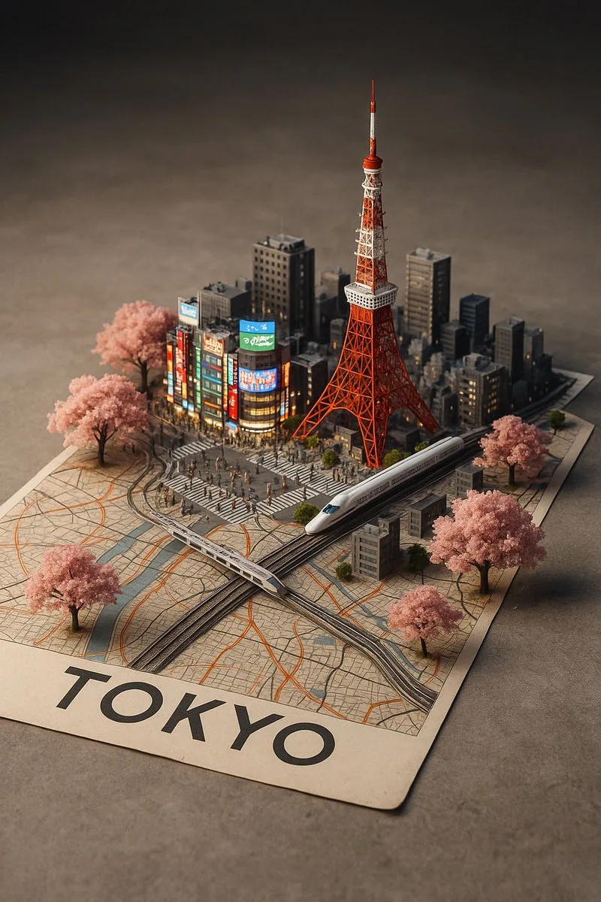

# Duet | AI — by @Sheldon056

[← Back to Community Examples](../../EXAMPLES.md) · Category: Illustration & 3D · Model: `Nano Banana`

<a href="https://x.com/Sheldon056/status/2019618076246090053"></a>

Source: **[@Sheldon056 on X](https://x.com/Sheldon056/status/2019618076246090053)** · Creator: [Duet | AI](https://x.com/Sheldon056)

## Prompt

```text
A street-style map of [CITY_NAME] placed on a {MAP_SURFACE}, with a photorealistic miniature version of [CITY_NAME] emerging from it [LANDMARK_1],[LANDMARK_2],[LANDMARK_3], [NATURE_ELEMENT], [URBAN_LIFE_ELEMENT], [ICONIC_TRANSPORT],and EXTRA_DETAIL.All elements grow from the map like a 3D urban diorama. Studio soft lighting, cinematic depth, 2:3 format
```

## Try it

Paste the prompt into **[vinano.ai](https://vinano.ai?utm_source=github&utm_medium=readme&utm_campaign=awesome-image-video-prompts-updating&utm_content=x-page-try)** to generate your own version.

> The image and prompt belong to @Sheldon056 ([original post](https://x.com/Sheldon056/status/2019618076246090053)) and are shown here with credit for reference. Creators can ask for changes or removal by opening an issue.
