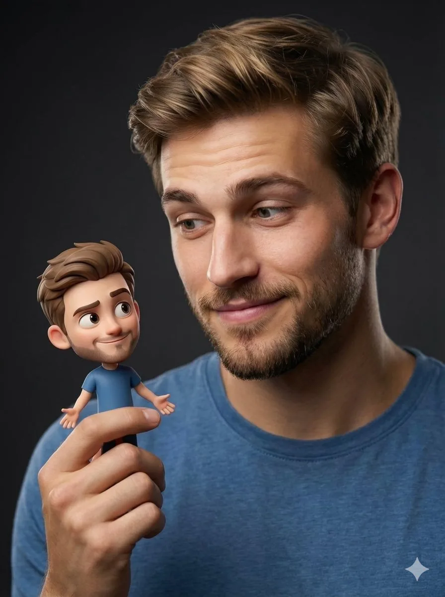

# Taaruk — by @Taaruk_

[← Back to Community Examples](../../EXAMPLES.md) · Category: Illustration & 3D · Model: `Nano Banana`

<a href="https://x.com/Taaruk_/status/2008818683234361811"></a>

Source: **[@Taaruk_ on X](https://x.com/Taaruk_/status/2008818683234361811)** · Creator: [Taaruk](https://x.com/Taaruk_)

## Prompt

```text
{
  "Objective": "Create a hyper-realistic studio portrait blending photorealism with a whimsical 3D cartoon miniature character",
  "PersonaDetails": {
    "PrimarySubject": {
      "Type": "Young man",
      "Appearance": {
        "Hair": "Light brown hair, neatly styled",
        "FacialHair": "Neatly trimmed beard",
        "Skin": "Photorealistic, natural texture"
      },
      "Expression": "Soft, warm smile",
      "Gaze": "Looking at the miniature character on his fingertips",
      "Wardrobe": "Blue t-shirt"
    },
    "SecondarySubject": {
      "Type": "Tiny 3D cartoon version of the man",
      "Scale": "Miniature, resting on fingertips",
      "Style": "Pixar-style 3D character design",
      "Proportions": "Exaggerated cute proportions",
      "Features": {
        "Eyes": "Large, expressive",
        "Expression": "Friendly, playful pose"
      },
      "Consistency": "Matching hairstyle and outfit of the main subject"
    }
  },
  "Composition": {
    "Framing": "Close-up studio portrait",
    "Focus": "Ultra-sharp focus on both faces",
    "DepthOfField": "Shallow depth of field with soft background blur",
    "Balance": "Clean, centered composition emphasizing interaction"
  },
  "LightingAndMood": {
    "LightingStyle": "Cinematic soft studio lighting",
    "Highlights": "Gentle highlights on skin and miniature character",
    "Background": "Dark neutral backdrop",
    "Mood": "Modern, whimsical, warm"
  },
  "ArtDirection": {
    "StyleFusion": [
      "Photorealistic human portrait",
      "Pixar-style 3D character rendering"
    ],
    "DetailLevel": "High detail with clean textures",
    "RealismBalance": "Realistic human combined with stylized miniature"
  },
  "PhotographyStyle": {
    "Genre": "Professional studio portrait photography",
    "LensLook": "85mm lens perspective",
    "ImageQuality": "High resolution, ultra-sharp clarity"
  },
  "ColorAndTone": {
    "ColorPalette": "Natural skin tones with soft, modern colors",
    "Contrast": "Balanced contrast, smooth tonal transitions"
  },
  "NegativePrompt": [
    "cartoon human",
    "uncanny valley",
    "harsh lighting",
    "oversaturated colors",
    "blurry faces",
    "low detail",
    "messy composition"
  ],
  "ResponseFormat": {
    "Type": "Single image",
    "Orientation": "Portrait",
    "AspectRatio": "2:3"
  }
}
```

## Try it

Paste the prompt into **[vinano.ai](https://vinano.ai?utm_source=github&utm_medium=readme&utm_campaign=awesome-image-video-prompts-updating&utm_content=x-page-try)** to generate your own version.

> The image and prompt belong to @Taaruk_ ([original post](https://x.com/Taaruk_/status/2008818683234361811)) and are shown here with credit for reference. Creators can ask for changes or removal by opening an issue.
