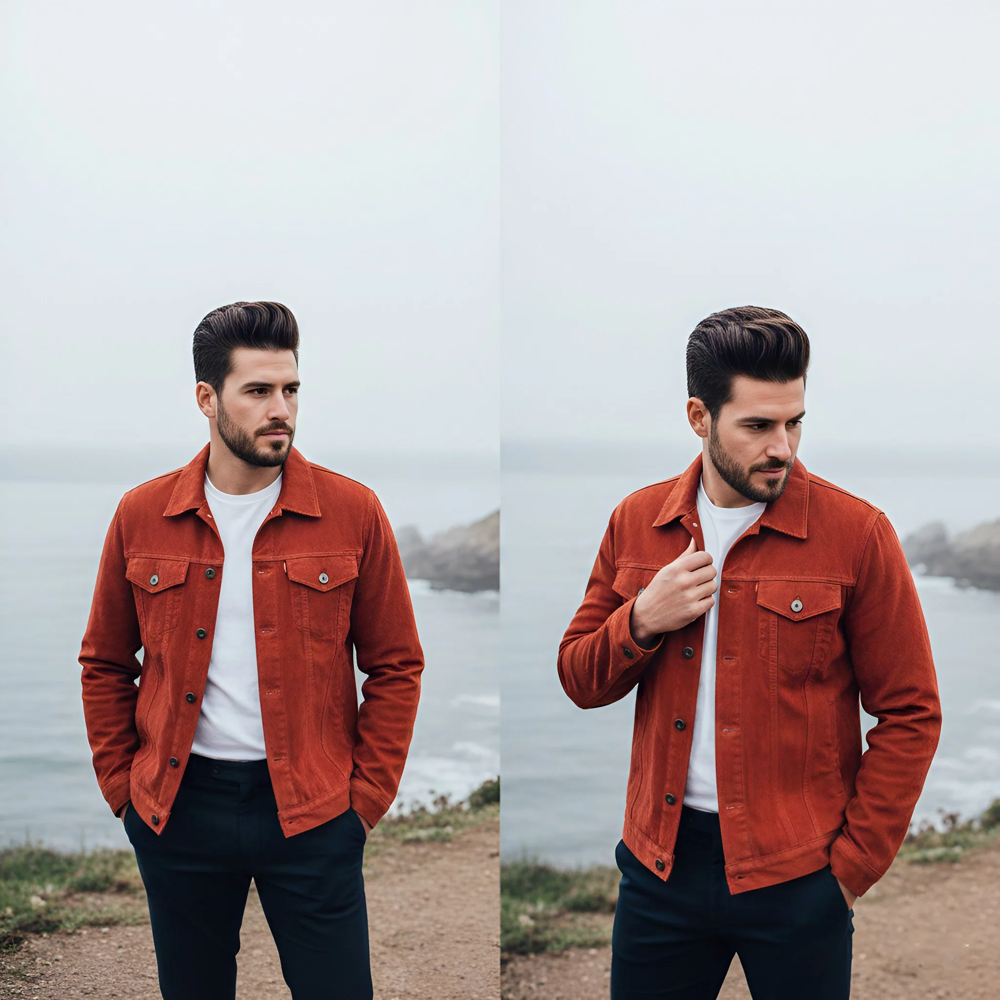

# Abhishek Singh — by @2abhisheknaks

[← Back to Examples from X](../../EXAMPLES.md) · Category: Photography · Model: `Nano Banana`

<a href="https://x.com/2abhisheknaks/status/2008113093117894773"></a>

Original post: **[@2abhisheknaks on X](https://x.com/2abhisheknaks/status/2008113093117894773)** · Creator: [Abhishek Singh](https://x.com/2abhisheknaks)

## Prompt

```text
{
  "image_description": "A high-quality side-by-side comparison of a handsome man posing on a coastal cliffside.",
  "subject": {
    "gender": "male",
    "appearance": "mid-30s, well-groomed beard, thick dark hair styled in a modern voluminous pompadour",
    "poses": [
      "standing with hands in pockets looking away from the camera",
      "standing with one hand adjusting the collar of his jacket"
    ]
  },
  "outfit": {
    "outerwear": "burnt orange or rust-colored corduroy trucker jacket with metal buttons",
    "base_layer": "crisp white crew-neck t-shirt",
    "bottoms": "dark navy blue or black slim-fit trousers"
  },
  "setting": {
    "location": "rugged coastal cliff overlooking the ocean",
    "background": "misty horizon, calm sea, rocky shoreline",
    "lighting": "overcast, soft diffused natural light, moody atmospheric fog"
  },
  "technical_details": {
    "camera_angle": "eye-level medium shot",
    "composition": "diptych (two images side-by-side)",
    "aesthetic": "lifestyle photography, cinematic color grading, shallow depth of field with soft background bokeh"
  }
}
```

## Try it

Paste the prompt into **[vinano.ai](https://vinano.ai?utm_source=github&utm_medium=readme&utm_campaign=awesome-image-video-prompts-updating&utm_content=x-page-try)** to generate your own version.

> The image and prompt belong to [@2abhisheknaks](https://x.com/2abhisheknaks) and are shown here with credit for reference. Creators can ask for changes or removal by opening an issue.
