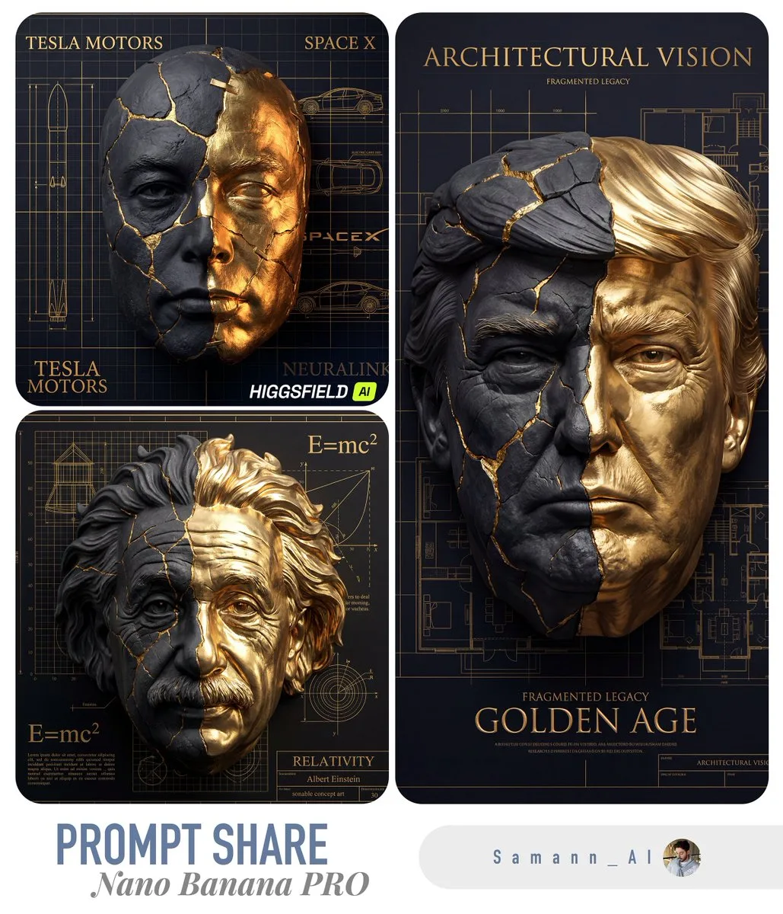

# Saman | AI — by @Samann_ai

[← Back to Examples from X](../../EXAMPLES.md) · Category: Illustration & 3D · Model: `Nano Banana`

<a href="https://x.com/Samann_ai/status/2018708807371628802"></a>

Original post: **[@Samann_ai on X](https://x.com/Samann_ai/status/2018708807371628802)** · Creator: [Saman | AI](https://x.com/Samann_ai)

## Prompt

```text
A high-detail artistic 3D portrait of the person in the photo, reimagined as a fragmented sculptural mask. The face is vertically split: one side is made of matte charcoal-black stone with deep cracks, while the other side is polished, radiant leaf gold. The entire composition is overlaid on a dark architectural blueprint background featuring intricate gold grid lines, technical diagrams, and elegant golden serif typography. Cinematic lighting, hyper-realistic textures, Kintsugi-inspired aesthetic, luxury conceptual art, 8k resolution, moody and sophisticated atmosphere.
```

## Try it

Paste the prompt into **[vinano.ai](https://vinano.ai?utm_source=github&utm_medium=readme&utm_campaign=awesome-image-video-prompts-updating&utm_content=x-page-try)** to generate your own version.

> The image and prompt belong to [@Samann_ai](https://x.com/Samann_ai) and are shown here with credit for reference. Creators can ask for changes or removal by opening an issue.
