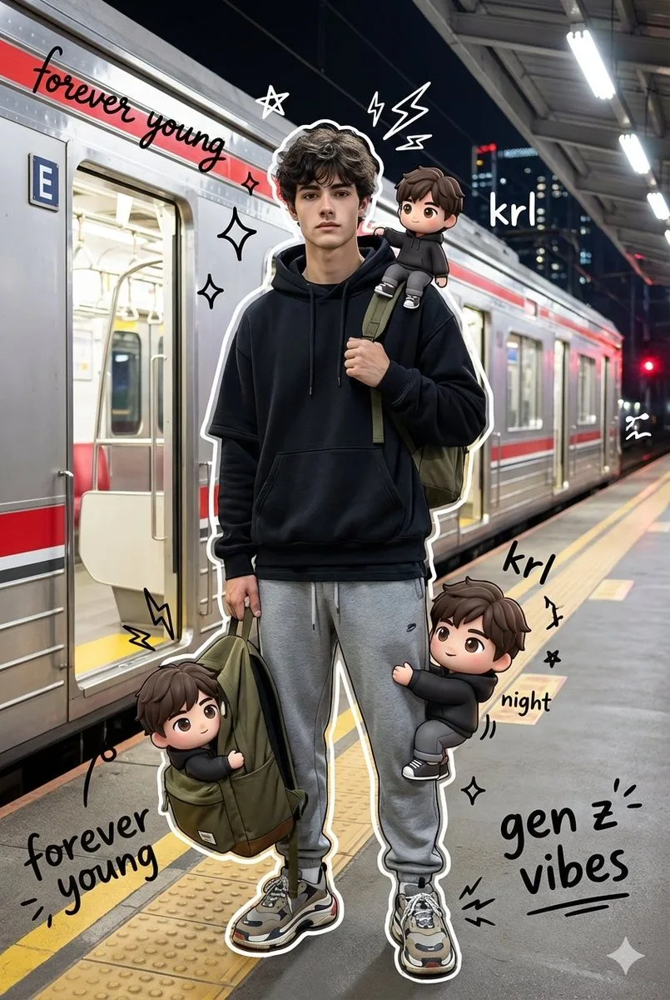

# Harboriis — by @harboriis

[← Back to Community Examples](../../EXAMPLES.md) · Category: Photography · Model: `Nano Banana`

<a href="https://x.com/harboriis/status/2021810779348140286"></a>

Source: **[@harboriis on X](https://x.com/harboriis/status/2021810779348140286)** · Creator: [Harboriis](https://x.com/harboriis)

## Prompt

```text
A high quality mixed media portrait of a trendy young man (using my uploaded person photo) standing on a train station platform at night. The subject is posing coolly, holding the strap of an olive backpack with one hand. He is wearing a stylish streetwear outfit with an oversized layered black hoodie, gray sweatpants, and chunky sneakers.

The background features a realistic KRL Jabodetabek Commuter Line train side view with its signature red striping, with the train doors wide open, bathed in bright cinematic station lighting and city night ambiance.

Surrounding the realistic main subject are several cute 3D style chibi versions of himself, same outfit and same face. These chibis are interacting playfully, one sitting on his shoulder, one climbing his leg, and another peeking out from the backpack.

Overlay the image with vibrant hand drawn doodle effects, white drawn outlines around the subject, playful scribbles, stars, sparkles, electric sparks, and floating white and black handwritten slogans like “forever young”, “krl”, “night”, and “gen z vibes”. The style should seamlessly blend hyper realistic photography with colorful flat cartoon illustrations while keeping the face and body shape unchanged.
```

## Try it

Paste the prompt into **[vinano.ai](https://vinano.ai?utm_source=github&utm_medium=readme&utm_campaign=awesome-image-video-prompts-updating&utm_content=x-page-try)** to generate your own version.

> The image and prompt belong to @harboriis ([original post](https://x.com/harboriis/status/2021810779348140286)) and are shown here with credit for reference. Creators can ask for changes or removal by opening an issue.
