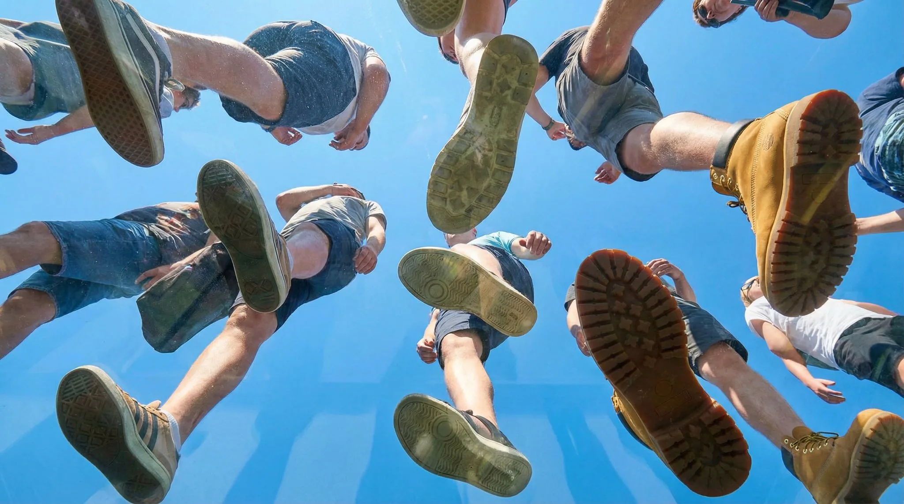

# Christopher Fryant — by @cfryant

[← Back to Examples from X](../../EXAMPLES.md) · Category: Photography · Model: `Nano Banana`

<a href="https://x.com/cfryant/status/2008198858405462492"></a>

Original post: **[@cfryant on X](https://x.com/cfryant/status/2008198858405462492)** · Creator: [Christopher Fryant](https://x.com/cfryant)

## Prompt

```text
View from under a plane of completely transparent plexiglass. We are looking straight up. Many people are walking on the plexiglass. In the background is a pure blue sky. No buildings visible. No edges or separations in the plexiglass. It’s as if the plexiglass isn’t even there. We are very close to the people. The people are in the process of walking. The people are walking generally from left to right. The soles of their shoes are very close to the foreground.
```

## Try it

Paste the prompt into **[vinano.ai](https://vinano.ai?utm_source=github&utm_medium=readme&utm_campaign=awesome-image-video-prompts-updating&utm_content=x-page-try)** to generate your own version.

> The image and prompt belong to [@cfryant](https://x.com/cfryant) and are shown here with credit for reference. Creators can ask for changes or removal by opening an issue.
