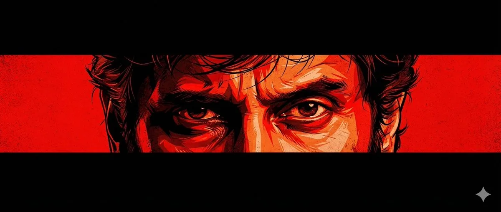

# Abhi — by @Abhiew_

[← Back to Examples from X](../../EXAMPLES.md) · Category: Illustration & 3D · Model: `Nano Banana`

<a href="https://x.com/Abhiew_/status/2017259594419228875"></a>

Original post: **[@Abhiew_ on X](https://x.com/Abhiew_/status/2017259594419228875)** · Creator: [Abhi](https://x.com/Abhiew_)

## Prompt

```text
A cinematic poster-style artwork featuring an intense close-up of a man’s eyes centered horizontally across the frame. Only the eyes and part of the face are visible through a narrow horizontal strip, surrounded by deep black negative space above and below. The face is illustrated in a high-contrast, graphic-novel style with bold red, black, and orange tones, dramatic shadows, sharp highlights, and a gritty, intense mood.
The eyes look fierce, emotional, and determined, with slightly messy hair. Use the provided image for eye reference
```

## Try it

Paste the prompt into **[vinano.ai](https://vinano.ai?utm_source=github&utm_medium=readme&utm_campaign=awesome-image-video-prompts-updating&utm_content=x-page-try)** to generate your own version.

> The image and prompt belong to [@Abhiew_](https://x.com/Abhiew_) and are shown here with credit for reference. Creators can ask for changes or removal by opening an issue.
