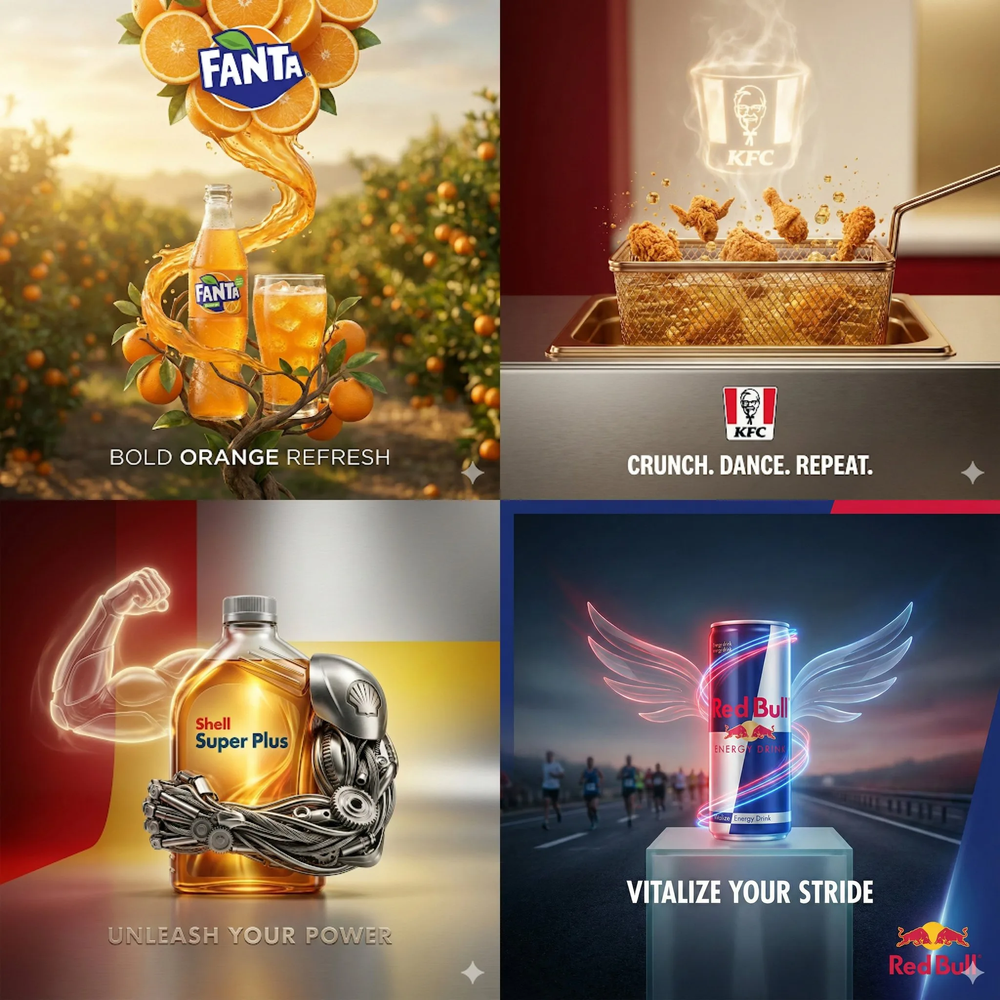

# AZIZ | AI 🇸🇦 — by @aziz4ai

[← Back to Community Examples](../../EXAMPLES.md) · Category: Food & Drink · Model: `Nano Banana`

<a href="https://x.com/aziz4ai/status/2008248159815036942"></a>

Source: **[@aziz4ai on X](https://x.com/aziz4ai/status/2008248159815036942)** · Creator: [AZIZ | AI 🇸🇦](https://x.com/aziz4ai)

## Prompt

```text
Create a realistic yet surreal creative advertisement for [PRODUCT NAME] in the [PRODUCT CATEGORY] space. The product must be the hero, centered in the frame, and visually “formed” in a smart way that automatically reflects the brand’s spirit and identity.

Use a clean, cohesive background that matches the brand’s color palette, with soft cinematic lighting, ultra-realistic premium materials, precise shadows, and a high-end editorial composition.

Add one innovative surreal touch directly tied to the product’s nature—creative but not exaggerated.

Integrate the real official product logo elegantly and seamlessly within the composition, and generate a short, powerful 3-word English slogan automatically that fits the product type and brand tone.

Ultra-high quality, perfectly balanced framing, strong realism, luxury style—no extra text beyond the logo and the 3-word English slogan.
```

## Try it

Paste the prompt into **[vinano.ai](https://vinano.ai?utm_source=github&utm_medium=readme&utm_campaign=awesome-image-video-prompts-updating&utm_content=x-page-try)** to generate your own version.

> The image and prompt belong to @aziz4ai ([original post](https://x.com/aziz4ai/status/2008248159815036942)) and are shown here with credit for reference. Creators can ask for changes or removal by opening an issue.
