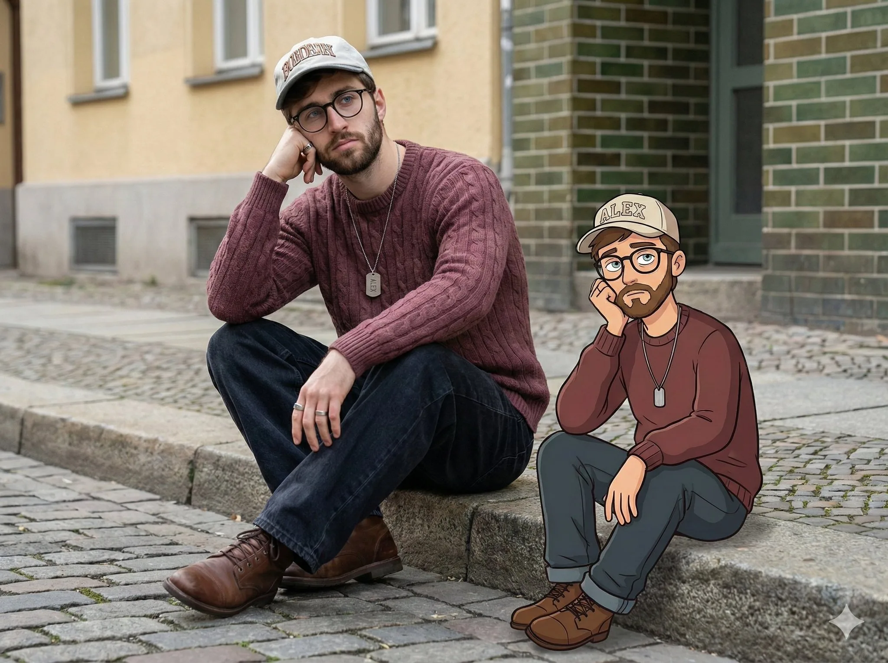

# Duet | AI — by @Sheldon056

[← Back to Community Examples](../../EXAMPLES.md) · Category: Photography · Model: `Nano Banana`

<a href="https://x.com/Sheldon056/status/2009458579305267681"></a>

Source: **[@Sheldon056 on X](https://x.com/Sheldon056/status/2009458579305267681)** · Creator: [Duet | AI](https://x.com/Sheldon056)

## Prompt

```text
Transform this image [Upload Your Image] into a 64K DSLR shot resolution of A creative urban street portrait featuring a young man (same face as the uploaded image) sitting on a curb in a quiet city street, paired with a stylized cartoon illustration of himself placed beside him. The real-life subject (same face as the uploaded image) is seated casually on a concrete sidewalk edge, resting his head on one hand in a bored, contemplative pose. He looks slightly upward with a neutral, introspective expression, conveying a sense of quiet thoughtfulness and urban solitude. He wears a muted maroon cable-knit sweater with a relaxed fit, dark loose-fitting denim jeans with subtle stitched details near the cuffs, and worn brown leather boots. Accessories include layered silver chain dog tag with the name "[Add Text]" written on it, rings on his fingers, black-framed glasses, and a light-coloured baseball cap with bold embroidered lettering on the front. His hair is short, dark hair, a well-groomed beard texture and character. Next to him on the sidewalk sits a small cartoon version (same face as the uploaded image) of himself, matching his outfit and pose exactly—same sweater, jeans, boots, cap, glasses, and facial expression. The illustrated character has clean outlines, warm muted colors, and a soft shaded, hand-drawn animation style, creating a playful contrast between realism and illustration. The cartoon figure is proportionally smaller, emphasizing a companion-like or inner-self concept. The background features textured cobblestone pavement, a curb edge, and a building facade with muted yellow walls and green-tiled brickwork near a window. The color palette is earthy and subdued, with natural daylight providing soft, even lighting and realistic shadows. The overall composition blends street photography, fashion portraiture, and mixed-media digital art, evoking themes of identity, self-reflection, and creativity.
Style & Mood Keywords: Urban street photography, casual fashion portrait, mixed media art, real and cartoon character duo, introspective mood, muted earthy tones, soft natural light, realistic textures, creative storytelling, high-resolution detail, cinematic realism. Octane render & Unreal Engine
```

## Try it

Paste the prompt into **[vinano.ai](https://vinano.ai?utm_source=github&utm_medium=readme&utm_campaign=awesome-image-video-prompts-updating&utm_content=x-page-try)** to generate your own version.

> The image and prompt belong to @Sheldon056 ([original post](https://x.com/Sheldon056/status/2009458579305267681)) and are shown here with credit for reference. Creators can ask for changes or removal by opening an issue.
