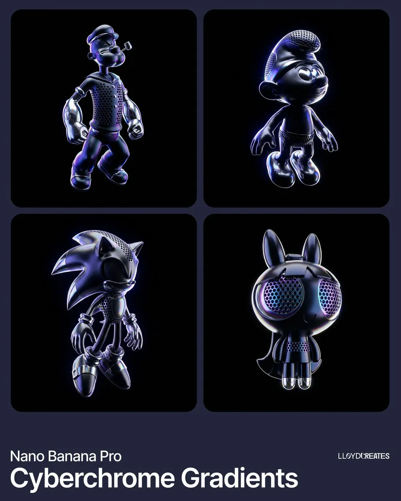

# Lloyd Creates — by @lloydcreates

[← Back to Examples from X](../../EXAMPLES.md) · Category: Illustration & 3D · Model: `Nano Banana`

<a href="https://x.com/lloydcreates/status/2026867752376418613"></a>

Original post: **[@lloydcreates on X](https://x.com/lloydcreates/status/2026867752376418613)** · Creator: [Lloyd Creates](https://x.com/lloydcreates)

## Prompt

```text
{
  "image_generation_request": {
    "subject_settings": {
      "product_placeholder": "[INSERT PRODUCT NAME HERE]",
      "positioning": "absolute center, floating, levitating, suspended in mid-air",
      "framing": "full view, no cropping, product must be entirely within frame, generous padding around edges"
    },
    "environment_and_background": {
      "background_color": "#000000",
      "background_type": "pure void, infinite black depth",
      "elements_to_exclude": [
        "lighting boxes",
        "softboxes",
        "stands",
        "pedestals",
        "platforms",
        "text",
        "watermarks",
        "props",
        "surface reflections",
        "studio equipment"
      ]
    },
    "texture_and_material_blending": {
      "primary_finish": "anodized obsidian metal with microscopic grit",
      "secondary_finish": "high-gloss fluid chrome",
      "accent_texture": "Mac Pro inspired precision-machined hemispherical lattice, 3D lattice venting pattern",
      "optical_effects": "monatomic light dispersion, prismatic diffraction on edges, ethereal holographic sheen"
    },
    "lighting_and_color_palette": {
      "key_colors": [
        { "name": "Pure Black", "hex": "#000000" },
        { "name": "Electric Indigo", "hex": "#4B0082" },
        { "name": "Phthalo Blue", "hex": "#000F89" },
        { "name": "Spectral Iridescence", "description": "Thin-film interference rainbow highlights" }
      ],
      "lighting_style": "hard rim lighting, chiaroscuro, high contrast, sharp specular highlights, no ambient fill"
    },
    "negative_constraints": {
      "strict_exclusion": "out of frame, cut off product, blurry edges, tripod, light stand, floor, table, shadows on floor, light flare icons, glowing boxes, copyright text, logo, cluttered background, grey tones, messy geometry"
    },
    "technical_specs": {
      "style": "Hyper-realistic 3D render",
      "engine_hints": "Octane Render, Raytraced, 8k, Unreal Engine 5, Cinematic Lighting"
    }
  }
}
```

## Try it

Paste the prompt into **[vinano.ai](https://vinano.ai?utm_source=github&utm_medium=readme&utm_campaign=awesome-image-video-prompts-updating&utm_content=x-page-try)** to generate your own version.

> The image and prompt belong to [@lloydcreates](https://x.com/lloydcreates) and are shown here with credit for reference. Creators can ask for changes or removal by opening an issue.
