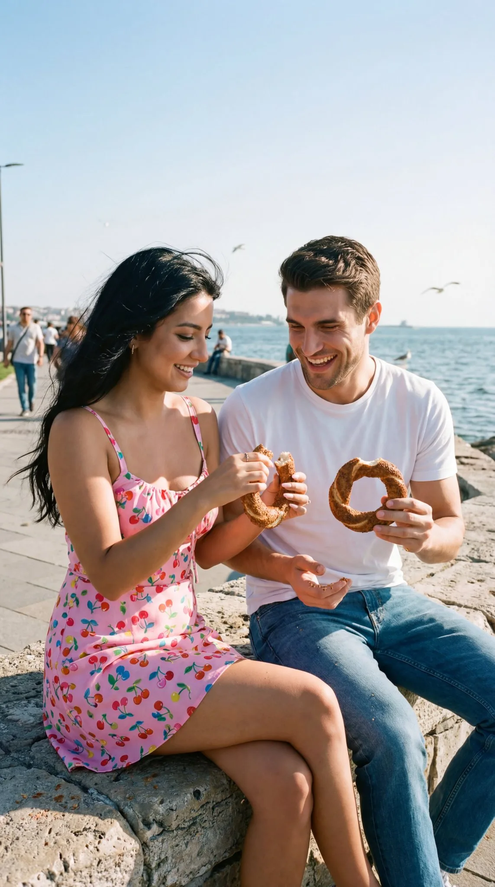

# Özge Döner — by @astronomerozge1

[← Back to Examples from X](../../EXAMPLES.md) · Category: Photography · Model: `Nano Banana`

<a href="https://x.com/astronomerozge1/status/2010681577987055947"></a>

Original post: **[@astronomerozge1 on X](https://x.com/astronomerozge1/status/2010681577987055947)** · Creator: [Özge Döner](https://x.com/astronomerozge1)

## Prompt

```text
{
  "generation_request": {
    "meta_data": {
      "tool": "NanoBanana Pro",
      "task_type": "photoreal_candid_street_romance",
      "version": "v1.2_MODA_SEASIDE_SIMIT_SUNNY_CHERRY_DRESS_EN",
      "priority": "highest"
    },

    "output_settings": {
      "aspect_ratio": "4:5",
      "orientation": "portrait",
      "resolution_target": "ultra_high_res",
      "render_style": "ultra_photoreal_candid_street_film_still",
      "sharpness": "crisp_but_natural",
      "film_grain": "subtle_35mm",
      "color_grade": "true_to_life_sunny_natural",
      "dynamic_range": "natural_not_hdr",
      "skin_rendering": "real_texture_no_retouch"
    },

    "global_rules": {
      "camera_language": "35mm lens equivalent, eye-level, imperfect framing, candid documentary feel, focus on eyes when people are present",
      "authenticity_markers": "subtle halation on highlights, tiny film gate weave, real street clutter, slight background motion blur only, no studio look",
      "lighting_language": "motivated natural light only (sunlight + sky fill), deep but detailed shadows"
    },

    "creative_prompt": {
      "scene_summary": "Moda seaside in Istanbul on a sunny day. A young couple in their early 20s sits near the shore eating simit. A candid, unposed film-still moment—quiet love inside everyday life.",

      "subjects": {
        "count": 2,
        "description": "the same young man and woman (early 20s), ordinary and real, not model-like; faces visible and eyes sharp",
        "expression": "small genuine smiles, relaxed presence, natural micro-expressions",
        "skin_and_face": "natural skin texture, no beauty retouch, no plastic skin, slight imperfections preserved"
      },

      "wardrobe_and_props": {
        "female": "pink dress with colorful cherry pattern, simple fit, slightly moving in sea breeze, natural minimal makeup, long wavy hair",
        "male": "blue denim jeans and a plain white t-shirt, slightly wrinkled, no logos",
        "props": "two simits in their hands, a simple tote/backpack nearby, no branding"
      },

      "micro_action": "they break pieces of simit, share a bite, laugh softly; the wind lifts the dress hem slightly; crumbs fall naturally onto their hands",

      "environment_details": {
        "location": "Moda coast, Istanbul",
        "background": "sea horizon, gentle waves, a few distant people walking softly out of focus, seagulls in the sky, sunlit railing and rocks",
        "ground_details": "worn stone or concrete edge, small everyday clutter (a bottle cap or leaf), but clean and believable, no staged props"
      },

      "lighting": "bright sunny daylight with soft sky fill; controlled highlights; subtle halation on sunlit edges; deep but detailed shadows under chins and clothing folds",

      "composition": "eye-level medium shot, slightly off-center, imperfect framing like real street photography; faces sharp; background gently receding; no perfect symmetry",

      "mood": "warm, simple, human—an everyday Istanbul love scene"
    },

    "negative_prompt": [
      "studio lighting",
      "beauty retouch",
      "plastic skin",
      "model faces",
      "posed romance poster look",
      "perfect symmetry",
      "HDR",
      "AI glow",
      "fake bokeh shapes",
      "overly clean staged scene",
      "text",
      "logo",
      "watermark",
      "cartoon",
      "painterly"
    ]
  }
}
```

## Try it

Paste the prompt into **[vinano.ai](https://vinano.ai?utm_source=github&utm_medium=readme&utm_campaign=awesome-image-video-prompts-updating&utm_content=x-page-try)** to generate your own version.

> The image and prompt belong to [@astronomerozge1](https://x.com/astronomerozge1) and are shown here with credit for reference. Creators can ask for changes or removal by opening an issue.
