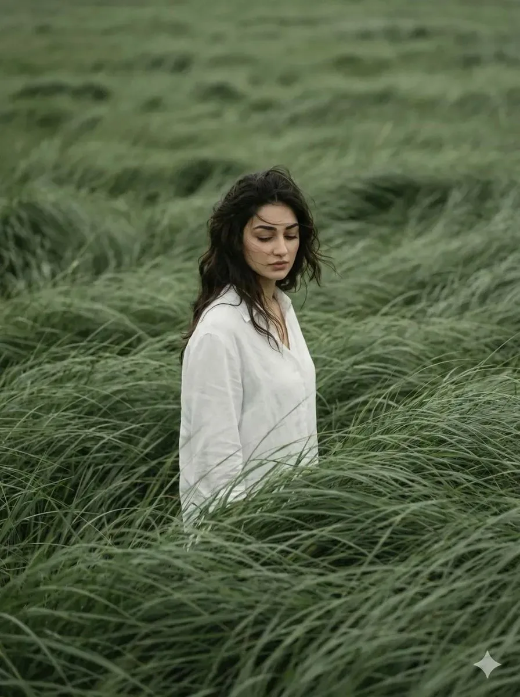

# Saul Goodman — by @Goodmanprotocol

[← Back to Examples from X](../../EXAMPLES.md) · Category: Photography · Model: `Nano Banana`

<a href="https://x.com/Goodmanprotocol/status/2038617381388583283"></a>

Original post: **[@Goodmanprotocol on X](https://x.com/Goodmanprotocol/status/2038617381388583283)** · Creator: [Saul Goodman](https://x.com/Goodmanprotocol)

## Prompt

```text
Create a 3:4 cinematic, atmospheric editorial portrait using the attached photo as the exact face and identity reference. A solitary man/woman stands alone in the middle of vast, wind-swept sage green grass fields. Tall grass surrounds the subject completely, flowing in strong currents like ocean waves, partially obscuring the body and creating motion,depth, and solitude. The subject wears a simple, loose white shirt that softly contrasts with the rich green landscape.
Dark hair is slightly messy, with natural strands moving in the wind. The head is gently tilted downward, eyes cast toward the ground, conveying a quiet, introspective, melancholic mood. Expression is calm, distant, and emotionally restrained. Compose the frame slightly off-center, from a subtle elevated angle. No visible horizon, the frame is fully immersed in grass texture. Use a muted natural palette of sage green, deep olive, and soft off-white. Shoot vertical 3:4, telephoto perspective, shallow depth of field, cinematic framing. Film photography aesthetic with visible grain, soft edge falloff, atmospheric light, wind-driven motion blur in the grass. Quiet, poetic storytelling; ultra-detailed yet natural, magazine-cover editorial quality. No text, no watermark.
```

## Try it

Paste the prompt into **[vinano.ai](https://vinano.ai?utm_source=github&utm_medium=readme&utm_campaign=awesome-image-video-prompts-updating&utm_content=x-page-try)** to generate your own version.

> The image and prompt belong to [@Goodmanprotocol](https://x.com/Goodmanprotocol) and are shown here with credit for reference. Creators can ask for changes or removal by opening an issue.
