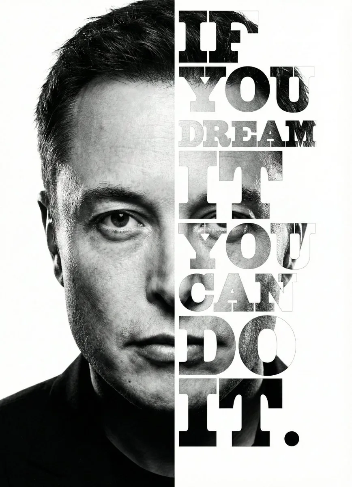

# Heisenberg — by @rovvmut_

[← Back to Community Examples](../../EXAMPLES.md) · Category: Photography · Model: `Nano Banana`

<a href="https://x.com/rovvmut_/status/2012132360779923648"></a>

Source: **[@rovvmut_ on X](https://x.com/rovvmut_/status/2012132360779923648)** · Creator: [Heisenberg](https://x.com/rovvmut_)

## Prompt

```text
{
  "meta": {
    "image_quality": "High",
    "image_type": "Digital Composite / Graphic Design",
    "resolution_estimation": "High resolution vertical poster format",
    "file_characteristics": {
      "compression_artifacts": "Low",
      "noise_level": "Low (film grain visible in photo texture)",
      "lens_type_estimation": "Telephoto (suggested by facial compression)"
    }
  },
  "global_context": {
    "scene_description": "A high-contrast, black and white split-composition portrait of Elon Musk. The left half of the image displays a realistic, high-detail photograph of the right side of his face (viewer's left). The right half of the image consists of a white background where the left side of his face (viewer's right) is revealed only through the shapes of large, bold, vertically stacked serif typography reading 'IF YOU DREAM IT YOU CAN DO IT.'",
    "environment_type": "Studio/Graphic Art",
    "time_of_day": "Indiscernible",
    "weather_atmosphere": "Visionary, Motivational, Intense",
    "lighting": {
      "source": "Artificial Studio Lighting",
      "direction": "Side lighting (lighting the face from the left)",
      "quality": "Hard, dramatic chiaroscuro",
      "color_temperature": "Monochrome (Black and White)"
    },
    "color_palette": {
      "dominant_hex_estimates": [
        "#FFFFFF",
        "#000000",
        "#333333",
        "#888888"
      ],
      "accent_colors": [],
      "contrast_level": "High"
    }
  },
  "composition": {
    "camera_angle": "Eye-level",
    "framing": "Close-up portrait",
    "depth_of_field": "Deep (all elements in focus)",
    "focal_point": "Subject's eyes and the typographic message",
    "symmetry_type": "Vertical Split Asymmetry",
    "rule_of_thirds_alignment": "The split occurs roughly along the vertical center line of the face (nose bridge)"
  },
  "objects": [
    {
      "id": "obj_subject_face",
      "label": "Elon Musk (Face)",
      "category": "Person",
      "location": {
        "relative_position": "Left half of canvas",
        "bounding_box_percentage": {
          "x": 0.0,
          "y": 0.0,
          "width": 0.5,
          "height": 1.0
        }
      },
      "dimensions_relative": "Large (fills height)",
      "distance_from_camera": "Close-up",
      "pose_orientation": "Front-facing, slight tilt, intense contemplative gaze",
      "material": "Skin/Biological",
      "surface_properties": {
        "texture": "Smooth skin, faint stubble, characteristic facial structure",
        "reflectivity": "Low (natural skin oil sheen on nose/cheek)",
        "micro_details": "Faint crow's feet, straight/wavy hair texture visible at top",
        "wear_state": "N/A"
      },
      "color_details": {
        "base_color_hex": "#808080",
        "secondary_colors": [
          "#000000",
          "#FFFFFF"
        ],
        "gradient_or_pattern": "Grayscale continuous tone"
      },
      "interaction_with_light": {
        "shadow_casting": "Deep shadows on the right side of the face (hidden by text mask)",
        "highlight_zones": "Forehead, bridge of nose, under-eye area on the lit side",
        "translucency": "None"
      },
      "relationships": [
        {
          "type": "visually_connected_to",
          "target_object_id": "obj_typography_mask"
        }
      ]
    },
    {
      "id": "obj_typography_mask",
      "label": "Typographic Overlay",
      "category": "Text/Graphic Element",
      "location": {
        "relative_position": "Right half of canvas",
        "bounding_box_percentage": {
          "x": 0.5,
          "y": 0.0,
          "width": 0.5,
          "height": 1.0
        }
      },
      "dimensions_relative": "Large",
      "distance_from_camera": "Surface Plane",
      "pose_orientation": "Vertical Stack",
      "material": "Digital Mask",
      "surface_properties": {
        "texture": "The fill of the letters matches the texture of Elon Musk's hair and skin (masked photo)",
        "reflectivity": "None",
        "micro_details": "Edges are sharp serif cuts",
        "wear_state": "N/A"
      },
      "color_details": {
        "base_color_hex": "#000000",
        "secondary_colors": [
          "#FFFFFF"
        ],
        "gradient_or_pattern": "Image texture inside letters, white background outside"
      },
      "interaction_with_light": {
        "shadow_casting": "None",
        "highlight_zones": "None",
        "translucency": "None"
      },
      "text_content": {
        "raw_text": "IF\nYOU\nDREAM\nIT\nYOU\nCAN\nDO\nIT.",
        "font_style": "Heavy Slab Serif (e.g., Rockwell Bold or similar)",
        "font_weight": "Bold / Black",
        "text_case": "Uppercase",
        "alignment": "Justified / Stacked",
        "color_hex": "Texture-filled (Black/Gray)"
      },
      "relationships": [
        {
          "type": "completes_image_of",
          "target_object_id": "obj_subject_face"
        }
      ]
    },
    {
      "id": "obj_clothing",
      "label": "Jacket Collar / Suit",
      "category": "Clothing",
      "location": {
        "relative_position": "Bottom Left Corner",
        "bounding_box_percentage": {
          "x": 0.0,
          "y": 0.85,
          "width": 0.4,
          "height": 0.15
        }
      },
      "dimensions_relative": "Small visible portion",
      "distance_from_camera": "Near",
      "pose_orientation": "Worn on shoulders",
      "material": "Dark Fabric/Leather",
      "surface_properties": {
        "texture": "Smooth with subtle folding",
        "reflectivity": "Medium",
        "micro_details": "Folds and creases",
        "wear_state": "Good condition"
      },
      "color_details": {
        "base_color_hex": "#1A1A1A",
        "secondary_colors": [],
        "gradient_or_pattern": "Solid dark"
      },
      "interaction_with_light": {
        "shadow_casting": "Self-shadowing in folds",
        "highlight_zones": "Ridges of folds",
        "translucency": "None"
      },
      "relationships": [
        {
          "type": "worn_by",
          "target_object_id": "obj_subject_face"
        }
      ]
    },
    {
      "id": "obj_ear",
      "label": "Left Ear",
      "category": "Body Part",
      "location": {
        "relative_position": "Center Left Edge",
        "bounding_box_percentage": {
          "x": 0.05,
          "y": 0.35,
          "width": 0.15,
          "height": 0.2
        }
      },
      "dimensions_relative": "Medium",
      "distance_from_camera": "Mid",
      "pose_orientation": "Side view",
      "material": "Skin",
      "surface_properties": {
        "texture": "Smooth skin",
        "reflectivity": "Low",
        "micro_details": "Cartilage structure visible",
        "wear_state": "N/A"
      },
      "color_details": {
        "base_color_hex": "#888888",
        "secondary_colors": [],
        "gradient_or_pattern": "N/A"
      },
      "interaction_with_light": {
        "shadow_casting": "Inner ear shadows",
        "highlight_zones": "Outer rim (helix)",
        "translucency": "Slight subsurface scattering potential"
      },
      "relationships": [
        {
          "type": "attached_to",
          "target_object_id": "obj_subject_face"
        }
      ]
    }
  ],
  "background_details": {
    "texture": "Flat color",
    "patterns": "None (Solid White)",
    "lighting_behavior": "The background is pure white (#FFFFFF), providing maximum contrast to the subject and text.",
    "additional_elements": [
      "Negative space on the right side acts as the canvas for the text masking effect."
    ]
  },
  "foreground_elements": {
    "particles": "None",
    "artifacts": "None"
  },
  "reconstruction_notes": {
    "mandatory_elements_for_recreation": [
      "Elon Musk's likeness",
      "Split face composition",
      "Typography masking effect on the right side",
      "Specific quote: 'IF YOU DREAM IT YOU CAN DO IT.'",
      "Black and white high-contrast aesthetic",
      "Serif bold font"
    ],
    "sensitivity_factors": "The alignment of the text must perfectly match the underlying facial anatomy to maintain the illusion of the face continuing through the letters. Hairline and jaw structure should be specific to Musk.",
    "ambiguities": "Clothing type is generic dark material."
  }
}
```

## Try it

Paste the prompt into **[vinano.ai](https://vinano.ai?utm_source=github&utm_medium=readme&utm_campaign=awesome-image-video-prompts-updating&utm_content=x-page-try)** to generate your own version.

> The image and prompt belong to @rovvmut_ ([original post](https://x.com/rovvmut_/status/2012132360779923648)) and are shown here with credit for reference. Creators can ask for changes or removal by opening an issue.
