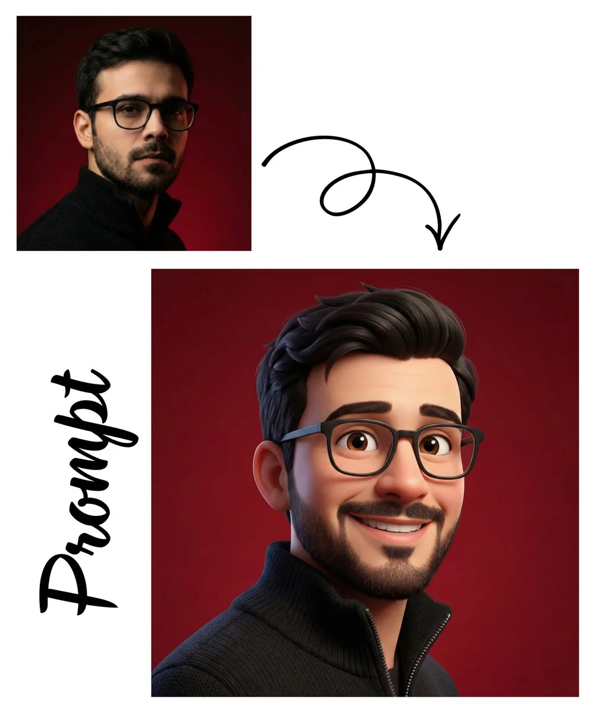

# Heisenberg — by @rovvmut_

[← Back to Community Examples](../../EXAMPLES.md) · Category: Illustration & 3D · Model: `Nano Banana`

<a href="https://x.com/rovvmut_/status/2013295220440654142"></a>

Source: **[@rovvmut_ on X](https://x.com/rovvmut_/status/2013295220440654142)** · Creator: [Heisenberg](https://x.com/rovvmut_)

## Prompt

```text
Create a high-quality 3D avatar of the person in the uploaded image with a cheerful, expressive face. The character should have a warm smile, bright eyes, and soft facial features that feel friendly and approachable. Render in a Pixar-style aesthetic with smooth textures, subtle skin shading, and slightly exaggerated proportions for a cute, animated look. Lighting should be soft and even, creating a clean studio look with gentle shadows for depth.
```

## Try it

Paste the prompt into **[vinano.ai](https://vinano.ai?utm_source=github&utm_medium=readme&utm_campaign=awesome-image-video-prompts-updating&utm_content=x-page-try)** to generate your own version.

> The image and prompt belong to @rovvmut_ ([original post](https://x.com/rovvmut_/status/2013295220440654142)) and are shown here with credit for reference. Creators can ask for changes or removal by opening an issue.
