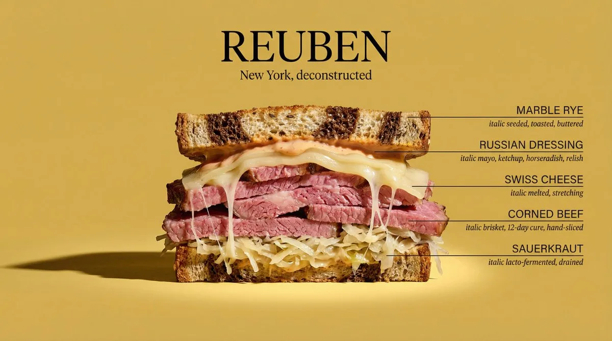

# Alexandra Aisling — by @AllaAisling

[← Back to Community Examples](../../EXAMPLES.md) · Category: Food & Drink · Model: `Nano Banana`

<a href="https://x.com/AllaAisling/status/2025686032700805436"></a>

Source: **[@AllaAisling on X](https://x.com/AllaAisling/status/2025686032700805436)** · Creator: [Alexandra Aisling](https://x.com/AllaAisling)

## Prompt

```text
Perfect cinematic cross-section cut through [DISH], sliced cleanly down the center revealing every internal layer in full detail. The cut face is facing the camera straight-on, like a geological diagram of flavor. Each visible layer is labeled with a thin horizontal line extending to the right — uppercase sans-serif "[INGREDIENT NAME]" with italic descriptor below. Background: flat matte [COLOR]. Lighting: dramatic side light from left casting long shadows, single warm spotlight on the cut face. Every texture hyperreal — visible moisture, air pockets, char, glaze, and steam. Mood: architectural food photography meets scientific illustration. Dish name "[DISH NAME]" in large elegant type at top. Subtitle: "[TAGLINE]". 4K, tack sharp, Style ref: Wes Anderson symmetry meets Michelin-star kitchen.
```

## Try it

Paste the prompt into **[vinano.ai](https://vinano.ai?utm_source=github&utm_medium=readme&utm_campaign=awesome-image-video-prompts-updating&utm_content=x-page-try)** to generate your own version.

> The image and prompt belong to @AllaAisling ([original post](https://x.com/AllaAisling/status/2025686032700805436)) and are shown here with credit for reference. Creators can ask for changes or removal by opening an issue.
