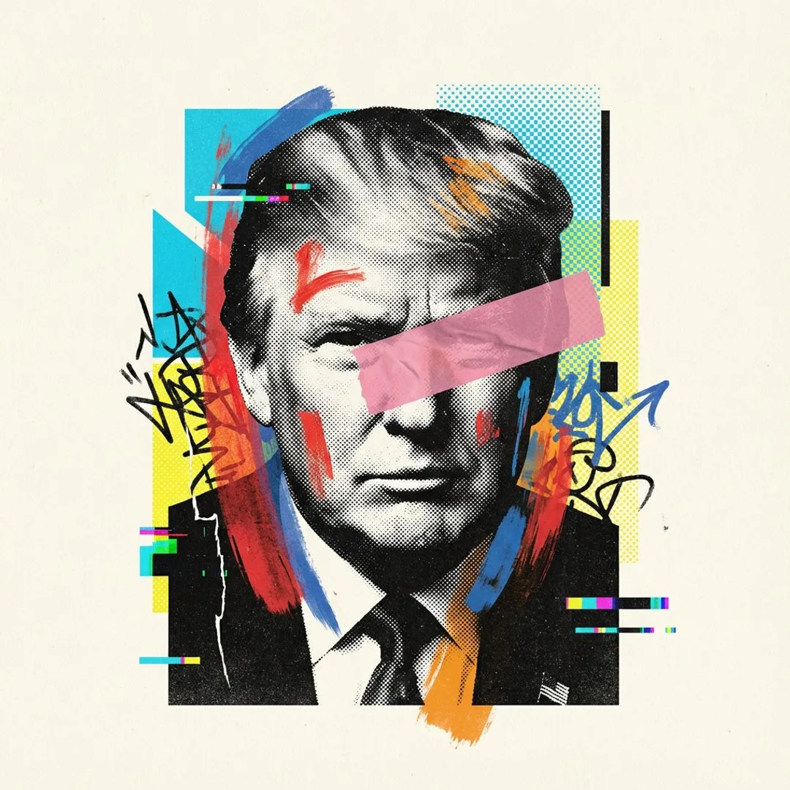

# AI Pulse — by @youraipulse

[← Back to Examples from X](../../EXAMPLES.md) · Category: Product & Brand · Model: `Nano Banana`

<a href="https://x.com/youraipulse/status/2008633447095349411"></a>

Original post: **[@youraipulse on X](https://x.com/youraipulse/status/2008633447095349411)** · Creator: [AI Pulse](https://x.com/youraipulse)

## Prompt

```text
[PERSON \ BRAND] visualized as the central masterpiece of a surreal avant-garde collage, style of modern mixed media editorial illustration. The subject is composed of high-contrast black and white stippled halftone textures blended with vibrant neo-expressionist elements. Overlay details include bold geometric shapes, cyan and yellow risograph patterns, abstract graffiti scribbles, and digital glitch artifacts. A thick strip of pink or orange tape or a color block obscures part of the form for a deconstructed look. The texture is grainy, mimicking vintage poster paper. The composition is strictly centered with a very wide, clean, off-white cream paper background, ensuring the entire subject is fully contained within the frame with generous negative space on all sides, zero cropping, minimal chic aesthetic.
```

## Try it

Paste the prompt into **[vinano.ai](https://vinano.ai?utm_source=github&utm_medium=readme&utm_campaign=awesome-image-video-prompts-updating&utm_content=x-page-try)** to generate your own version.

> The image and prompt belong to [@youraipulse](https://x.com/youraipulse) and are shown here with credit for reference. Creators can ask for changes or removal by opening an issue.
