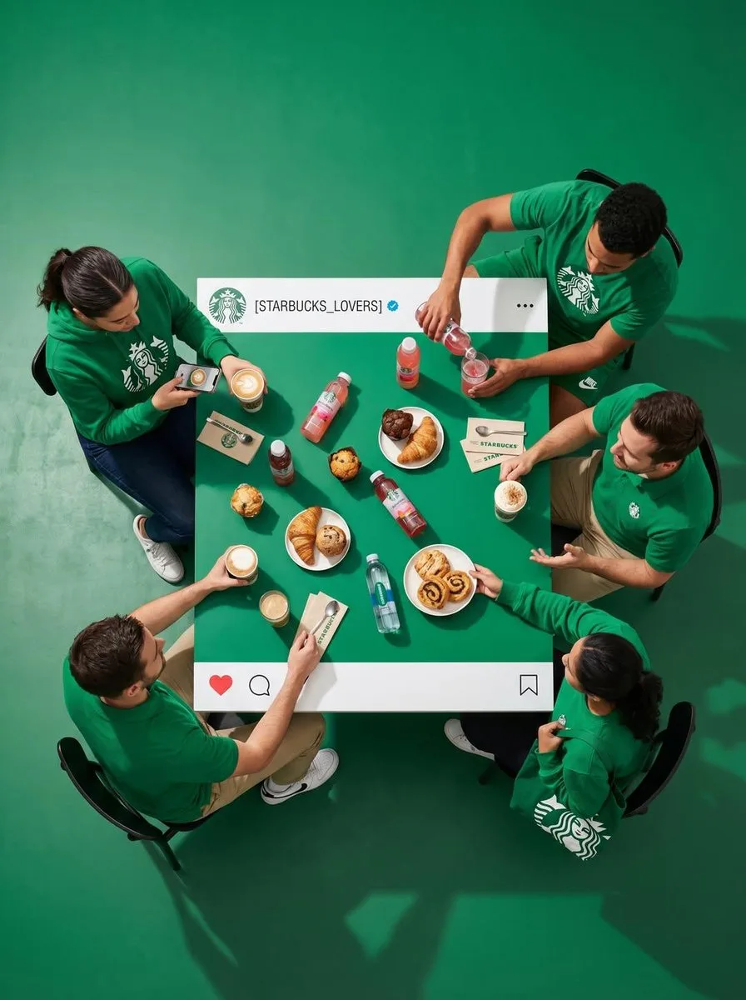

# Saul Goodman — by @Goodmanprotocol

[← Back to Examples from X](../../EXAMPLES.md) · Category: Poster Design · Model: `Nano Banana`

<a href="https://x.com/Goodmanprotocol/status/2045009725218226475"></a>

Original post: **[@Goodmanprotocol on X](https://x.com/Goodmanprotocol/status/2045009725218226475)** · Creator: [Saul Goodman](https://x.com/Goodmanprotocol)

## Prompt

```text
Ultra-wide-angle hyper-realistic shooting in top-down mode. A group of 4 real people sitting at a square dining table. The camera is pushed far back, creating a significant negative space (empty floor area) around the people and the table, which provides a clear, minimalistic composition. Scene [ATMOSPHERE AND CLOTHING]: Four people are dressed in [STYLE OF CLOTHING]. Their interaction is specific: [DESCRIBE EACH PERSON'S ACTIONS]. The table is a custom-made physical prop, designed as an Instagram post: it has a solid white stripe ONLY along the top and bottom edges (no white frames on the left or right). - The upper white stripe shows a drawn profile photo with [LOGO DESCRIPTION], the username "[USERNAME]", followed by a small blue icon with a confirmed check mark, and "..." on the right. - Red hearts, comment and share icons are painted on the bottom white stripe on the left, and a Bookmarks icon on the right. The center of the table is filled in [THE EXACT COLOR OF THE CENTER and the hexadecimal CODE]. The table shows [FOOD ITEMS/ITEM DESCRIPTIONS]. important: ALL food, beverages, objects, and hands that interact with them must be located strictly within this central area, colored in [COLOR]. NOTHING should go beyond the white stripes or beyond the table. The background of the floor is made in [THE COLOR OF THE FLOOR] to create a visual separation. Professional studio lighting with clear shadows. 8k, clear focus.
```

## Try it

Paste the prompt into **[vinano.ai](https://vinano.ai?utm_source=github&utm_medium=readme&utm_campaign=awesome-image-video-prompts-updating&utm_content=x-page-try)** to generate your own version.

> The image and prompt belong to [@Goodmanprotocol](https://x.com/Goodmanprotocol) and are shown here with credit for reference. Creators can ask for changes or removal by opening an issue.
