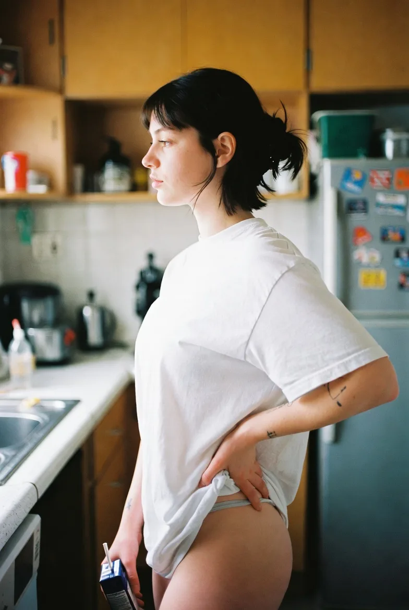

# Keskin — by @craftian_keskin

[← Back to Examples from X](../../EXAMPLES.md) · Category: Photography · Model: `Nano Banana`

<a href="https://x.com/craftian_keskin/status/2010784341975318837"></a>

Original post: **[@craftian_keskin on X](https://x.com/craftian_keskin/status/2010784341975318837)** · Creator: [Keskin](https://x.com/craftian_keskin)

## Prompt

```text
{
  "type": "image_generation_prompt",
  "style": "photorealistic, lifestyle photography",
  "sexualization": "none",
  "description": {
    "subject": "A young woman standing casually in a home kitchen, seen in side profile",
    "pose": "Relaxed posture, one hand resting on her hip while the other holds a small drink carton with a straw",
    "expression": "Neutral, thoughtful, slightly distant gaze looking forward",
    "appearance": {
      "hair": "Dark hair tied in a loose low bun with natural strands framing the face",
      "clothing": "Oversized white t-shirt worn casually, simple underwear partially visible due to the relaxed fit of the shirt",
      "tattoos": "Small, minimal black-ink tattoos on the forearm, subtle and understated"
    }
  },
  "environment": {
    "location": "A modest, lived-in home kitchen",
    "details": "Wooden cabinets, countertop appliances, a refrigerator covered with colorful magnets and souvenirs",
    "lighting": "Soft natural daylight coming from a window, warm and slightly muted",
    "atmosphere": "Quiet, everyday domestic moment"
  },
  "camera": {
    "angle": "Side profile view",
    "framing": "Medium shot capturing the subject from mid-thigh to head",
    "lens": "35mm lifestyle lens",
    "depth_of_field": "Moderate, background softly in focus to preserve environmental context"
  },
  "image_quality": {
    "realism": "High",
    "texture_detail": "Natural fabric folds, skin texture, and kitchen surface details visible",
    "grain": "Light natural film grain for an authentic look"
  },
  "mood": "Calm, intimate, documentary-style",
  "constraints": [
    "Non-sexualized, everyday realism",
    "Focus on natural lifestyle and atmosphere",
    "No exaggerated poses or expressions",
    "Candid, slice-of-life aesthetic"
  ]
}
```

## Try it

Paste the prompt into **[vinano.ai](https://vinano.ai?utm_source=github&utm_medium=readme&utm_campaign=awesome-image-video-prompts-updating&utm_content=x-page-try)** to generate your own version.

> The image and prompt belong to [@craftian_keskin](https://x.com/craftian_keskin) and are shown here with credit for reference. Creators can ask for changes or removal by opening an issue.
