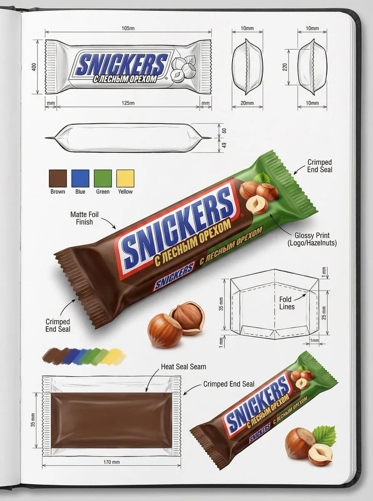

# Tips Excel — by @gudanglifehack

[← Back to Community Examples](../../EXAMPLES.md) · Category: Food & Drink · Model: `Nano Banana`

<a href="https://x.com/gudanglifehack/status/2038342534024544736"></a>

Source: **[@gudanglifehack on X](https://x.com/gudanglifehack/status/2038342534024544736)** · Creator: [Tips Excel](https://x.com/gudanglifehack)

## Prompt

```text
Using the attached image, create an illustration sheet of professional industrial design packaging for the package (PACKAGE TYPE). A centered heroic 3D rendering with realistic materials, soft studio lighting and commercial quality finishes. Surrounded by technical views: front, side, top, bottom, oblique perspective and flat position. Include sketches of the frame structure, crease lines, seam details, and size arrows in millimeters. Show materials and finishes (matte, glossy print, plastic, paper, glass, etc.) in handwritten annotations. Add color swatches, realistic product illustrations, and subtle shadows. Clean sketchbook background, realistic rendering + pencil sketch style, modern design design, ultra-detailed, portfolio ready.
```

## Try it

Paste the prompt into **[vinano.ai](https://vinano.ai?utm_source=github&utm_medium=readme&utm_campaign=awesome-image-video-prompts-updating&utm_content=x-page-try)** to generate your own version.

> The image and prompt belong to @gudanglifehack ([original post](https://x.com/gudanglifehack/status/2038342534024544736)) and are shown here with credit for reference. Creators can ask for changes or removal by opening an issue.
