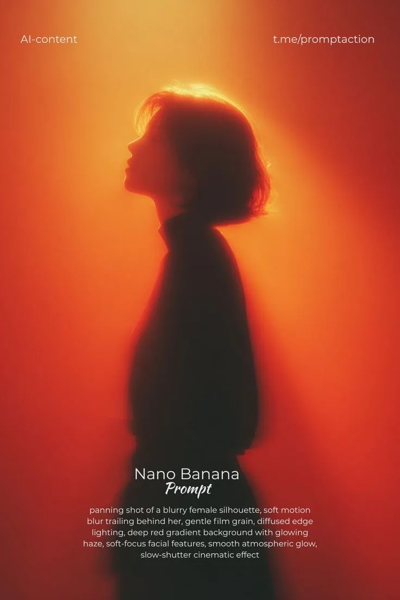

# Next Step © — by @nextstepst

[← Back to Community Examples](../../EXAMPLES.md) · Category: Photography · Model: `Nano Banana`

<a href="https://x.com/nextstepst/status/2026308234420666586"></a>

Source: **[@nextstepst on X](https://x.com/nextstepst/status/2026308234420666586)** · Creator: [Next Step ©](https://x.com/nextstepst)

## Prompt

```text
panning shot of a blurry female silhouette, soft motion blur trailing behind her, gentle film grain, diffused edge lighting, deep red gradient background with glowing haze, soft-focus facial features, smooth atmospheric glow,

slow-shutter cinematic effect
```

## Try it

Paste the prompt into **[vinano.ai](https://vinano.ai?utm_source=github&utm_medium=readme&utm_campaign=awesome-image-video-prompts-updating&utm_content=x-page-try)** to generate your own version.

> The image and prompt belong to @nextstepst ([original post](https://x.com/nextstepst/status/2026308234420666586)) and are shown here with credit for reference. Creators can ask for changes or removal by opening an issue.
