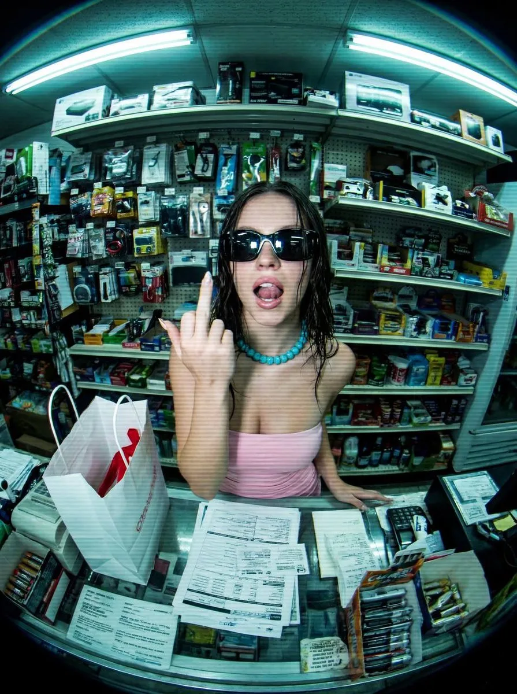

# Melisa♡ — by @xmliisu

[← Back to Community Examples](../../EXAMPLES.md) · Category: Photography · Model: `Nano Banana`

<a href="https://x.com/xmliisu/status/2015679962573889621"></a>

Source: **[@xmliisu on X](https://x.com/xmliisu/status/2015679962573889621)** · Creator: [Melisa♡](https://x.com/xmliisu)

## Prompt

```text
{
  "image_description": {
    "title": "Surveillance Feed: Defiant Subject in Retail Shop",
    "aspect_ratio": "4:5",
    "mood": "Raw, gritty, confrontational, authentic"
  },
  "visual_elements": {
    "subject": {
      "framing": "Centered from mid-torso upward",
      "pose": "Head tilted back looking up at camera, relaxed yet defiant posture",
      "action": "Hand raised with middle finger extended (silhouette, ghosted by motion)",
      "facial_features": "Largely obscured by blur, mouth open with tongue faintly visible",
      "apparel": "Dark oversized sunglasses reflecting ambient light"
    },
    "environment": {
      "location": "Cramped retail shop interior",
      "foreground": "Cluttered checkout counter, papers, white shopping bag with red rope handles",
      "background": "Densely packed shelves with small items, souvenirs, and figurines (abstracted by low resolution)"
    }
  },
  "technical_specifications": {
    "camera_perspective": "High-mounted, steep downward angle, top-down CCTV view",
    "lens_distortion": "Subtle fisheye warping at frame edges",
    "lighting": "Harsh flat fluorescent, blown highlights, dull shadows",
    "color_grading": "Cool green-blue cast, uneven color reproduction, visible banding, reduced dynamic range"
  },
  "image_fidelity": {
    "quality": "Intentionally degraded, low-fidelity",
    "artifacts": [
      "Strong motion blur",
      "Digital smearing",
      "Compression artifacts",
      "Heavy noise",
      "Scan lines"
    ],
    "sharpness": "Low perceived sharpness, distinct details stretched and indistinct"
  },
  "full_prompt_text": "A heavily distorted, low-fidelity surveillance-style image depicts the Subject standing behind a cramped retail checkout counter inside a cluttered shop, captured from a high-mounted camera angled steeply downward in a top-down CCTV perspective. The image quality is intentionally degraded, with strong motion blur, digital smearing, compression artifacts, heavy noise, scan lines, and subtle fisheye distortion warping the frame edges, making fine details indistinct and stretched. The Subject is centered from mid-torso upward, looking up toward the camera with the head tilted back; facial features are largely obscured by blur and artifacts, though dark oversized sunglasses dominate the face, reflecting ambient light, and the mouth appears open with the tongue faintly visible. One hand is raised toward the camera with the middle finger extended, clearly readable in silhouette but softened and ghosted by motion and low clarity, conveying a relaxed yet defiant posture. The foreground checkout counter is cluttered with papers and a white shopping bag with red rope handles, while the background shelves are densely packed with small items, souvenirs, and figurines that blend into abstract shapes due to low resolution and noise. Harsh, flat fluorescent lighting produces blown highlights, dull shadows, uneven color reproduction, and a cool green-blue color cast with visible banding and reduced dynamic range. Despite an effectively deep depth of field, perceived sharpness remains low, reinforcing a raw, gritty, confrontational mood that emphasizes the authenticity of an unpolished, unenhanced surveillance feed in a vertical 4:5 aspect ratio"
}
```

## Try it

Paste the prompt into **[vinano.ai](https://vinano.ai?utm_source=github&utm_medium=readme&utm_campaign=awesome-image-video-prompts-updating&utm_content=x-page-try)** to generate your own version.

> The image and prompt belong to @xmliisu ([original post](https://x.com/xmliisu/status/2015679962573889621)) and are shown here with credit for reference. Creators can ask for changes or removal by opening an issue.
