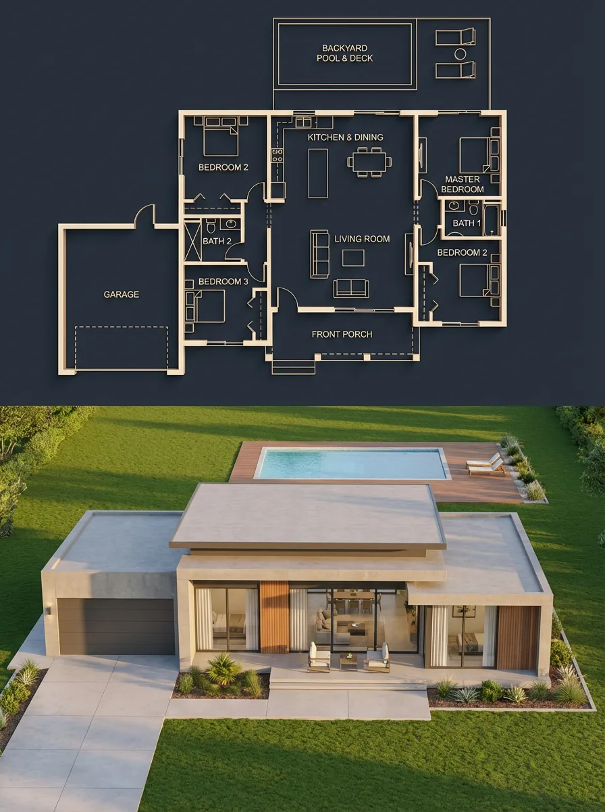

# Keskin — by @craftian_keskin

[← Back to Examples from X](../../EXAMPLES.md) · Category: UI & Graphic · Model: `Nano Banana`

<a href="https://x.com/craftian_keskin/status/2040757362382798888"></a>

Original post: **[@craftian_keskin on X](https://x.com/craftian_keskin/status/2040757362382798888)** · Creator: [Keskin](https://x.com/craftian_keskin)

## Prompt

```text
{
  "objective": "Create a split architectural visualization where the top is a detailed dark-themed blueprint and the bottom is a photorealistic house that matches the blueprint EXACTLY",

  "aspect_ratio": "3:4",

  "composition": {
    "layout": "vertical split",
    "top_section": "blueprint",
    "bottom_section": "realistic render",
    "alignment": "perfect structural correspondence between both sections"
  },

  "top_section": {
    "type": "architectural blueprint",
    "style": "dark luxury blueprint (similar to reference image 2)",

    "visual_style": {
      "background": "deep navy / charcoal blue",
      "lines": "thin glowing beige/gold lines",
      "walls": "slightly extruded 3D effect",
      "labels": "clean modern sans-serif",
      "lighting": "soft ambient glow"
    },

    "content": {
      "rooms": [
        "3 bedrooms (left, right, bottom-right)",
        "central living room",
        "kitchen + dining (top center)",
        "2 bathrooms",
        "garage (left side connected)",
        "front porch",
        "backyard pool with deck"
      ],
      "details": [
        "furniture outlines (beds, sofa, dining table)",
        "door swings and openings",
        "window placements",
        "circulation paths",
        "exact proportions and spacing"
      ]
    }
  },

  "bottom_section": {
    "type": "photorealistic house render",

    "constraint": "MUST MATCH THE BLUEPRINT EXACTLY — no added, removed, or shifted rooms",

    "architecture": {
      "style": "modern single-story house",
      "roof": "flat layered roof",
      "materials": [
        "smooth concrete walls",
        "wood panel accents",
        "large glass windows"
      ]
    },

    "layout_mapping_rules": [
      "garage must be on the left side exactly as blueprint",
      "main entrance aligned with living room",
      "pool positioned in backyard matching blueprint dimensions",
      "window placements correspond to each room location",
      "bedroom volumes visible externally in correct positions"
    ],

    "environment": {
      "setting": "suburban neighborhood",
      "elements": [
        "green lawn",
        "minimal landscaping",
        "clean driveway leading to garage",
        "pool deck matching blueprint footprint"
      ]
    },

    "lighting": {
      "time": "golden hour",
      "style": "soft natural light with realistic shadows"
    },

    "camera": {
      "angle": "slightly elevated front perspective",
      "lens": "35mm architectural view"
    }
  },

  "consistency_rules": [
    "room positions must be identical between blueprint and render",
    "no extra structures added in render",
    "all doors and windows must align logically",
    "pool size and placement must match exactly",
    "garage placement must match blueprint"
  ],

  "style": {
    "top": "architectural visualization (dark premium)",
    "bottom": "photorealistic modern house",
    "overall": "clean, high-end architectural presentation"
  },

  "negative_constraints": [
    "no mismatch between blueprint and render",
    "no extra rooms",
    "no fantasy elements",
    "no unrealistic proportions",
    "no cluttered environment"
  ]
}
```

## Try it

Paste the prompt into **[vinano.ai](https://vinano.ai?utm_source=github&utm_medium=readme&utm_campaign=awesome-image-video-prompts-updating&utm_content=x-page-try)** to generate your own version.

> The image and prompt belong to [@craftian_keskin](https://x.com/craftian_keskin) and are shown here with credit for reference. Creators can ask for changes or removal by opening an issue.
