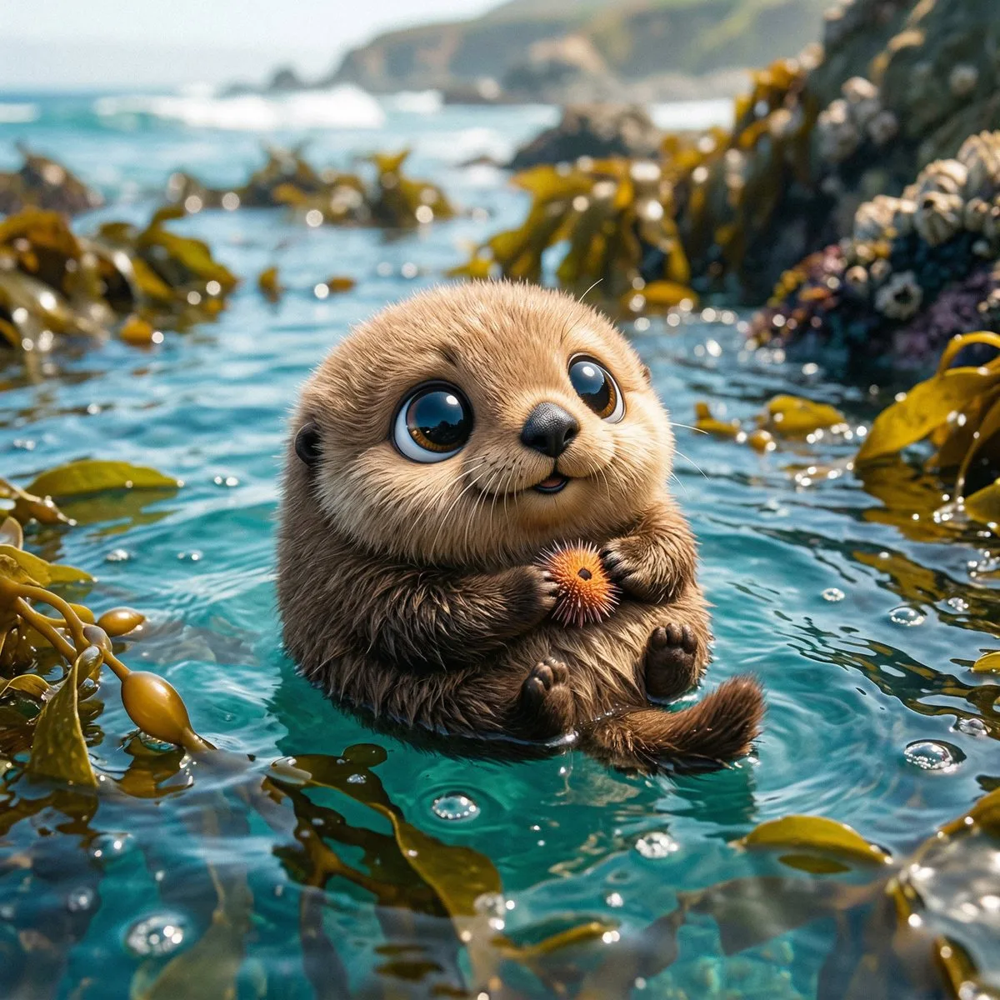

# Nano Banana 2 — by @NanoBanana

[← Back to Community Examples](../../EXAMPLES.md) · Category: Illustration & 3D · Model: `Nano Banana`

<a href="https://x.com/NanoBanana/status/2027298143134478451"></a>

Source: **[@NanoBanana on X](https://x.com/NanoBanana/status/2027298143134478451)** · Creator: [Nano Banana 2](https://x.com/NanoBanana)

## Prompt

```text
Make a photo of a cute ball-shaped version of a [animal], with big adorable over-sized eyes, it has no head, instead its face is part of the ball, its head and body are one. They are in their usual habitat. Must be almost spherical and cartoonishly cute. Its eyes are looking up in the most adorable cheeky fashion.
```

## Try it

Paste the prompt into **[vinano.ai](https://vinano.ai?utm_source=github&utm_medium=readme&utm_campaign=awesome-image-video-prompts-updating&utm_content=x-page-try)** to generate your own version.

> The image and prompt belong to @NanoBanana ([original post](https://x.com/NanoBanana/status/2027298143134478451)) and are shown here with credit for reference. Creators can ask for changes or removal by opening an issue.
