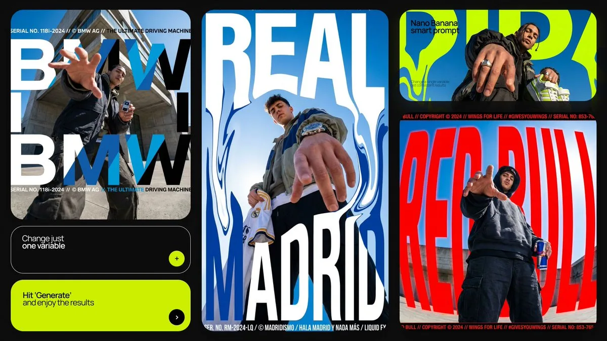

# AmirMušić — by @AmirMushich

[← Back to Examples from X](../../EXAMPLES.md) · Category: Poster Design · Model: `Nano Banana`

<a href="https://x.com/AmirMushich/status/2025261764795826531"></a>

Original post: **[@AmirMushich on X](https://x.com/AmirMushich/status/2025261764795826531)** · Creator: [AmirMušić](https://x.com/AmirMushich)

## Prompt

```text
Graphic design smart prompt

Generate ad posters in Nano Banana

This prompt generates:
• POV low-angle photo (pointing at viewer)
• Oversized text + brand tagline
• Serial numbers, copyright lines, technical callouts
• Brand-appropriate color blocking and texture

Use case: 
• social media posting,
• influencer collab visuals,
• pitch decks. 

Prompt 👇
```

## Try it

Paste the prompt into **[vinano.ai](https://vinano.ai?utm_source=github&utm_medium=readme&utm_campaign=awesome-image-video-prompts-updating&utm_content=x-page-try)** to generate your own version.

> The image and prompt belong to [@AmirMushich](https://x.com/AmirMushich) and are shown here with credit for reference. Creators can ask for changes or removal by opening an issue.
