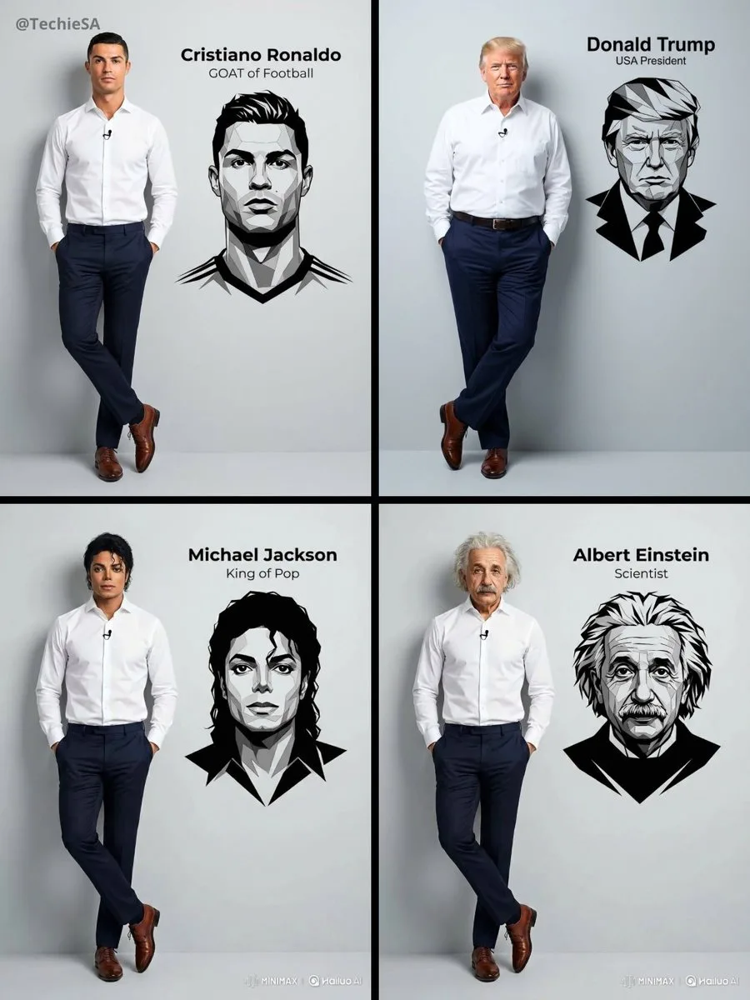

# TechieSA — by @TechieBySA

[← Back to Community Examples](../../EXAMPLES.md) · Category: Photography · Model: `Nano Banana`

<a href="https://x.com/TechieBySA/status/2011898760650170378"></a>

Source: **[@TechieBySA on X](https://x.com/TechieBySA/status/2011898760650170378)** · Creator: [TechieSA](https://x.com/TechieBySA)

## Prompt

```text
Ultra-realistic 8K full body portrait of [PERSON’S FULL NAME], wearing a clean and pressed white social shirt with folded collar and a small lapel microphone, dark navy-blue dress pants and polished brown social shoes. Casually and unpretentiously leaning against a smooth light gray studio wall; hands are in pockets and one leg is crossed over the other, with relaxed and confident body language. Add to the wall next to them a prominent vector portrait in black and white of their face and bust - with sharp lines and angles, overlapping polygonal shapes and a minimalist modern graphic style, right below the information: “[PERSON’S FULL NAME]”, and below the name: “[PROFESSION]”
```

## Try it

Paste the prompt into **[vinano.ai](https://vinano.ai?utm_source=github&utm_medium=readme&utm_campaign=awesome-image-video-prompts-updating&utm_content=x-page-try)** to generate your own version.

> The image and prompt belong to @TechieBySA ([original post](https://x.com/TechieBySA/status/2011898760650170378)) and are shown here with credit for reference. Creators can ask for changes or removal by opening an issue.
