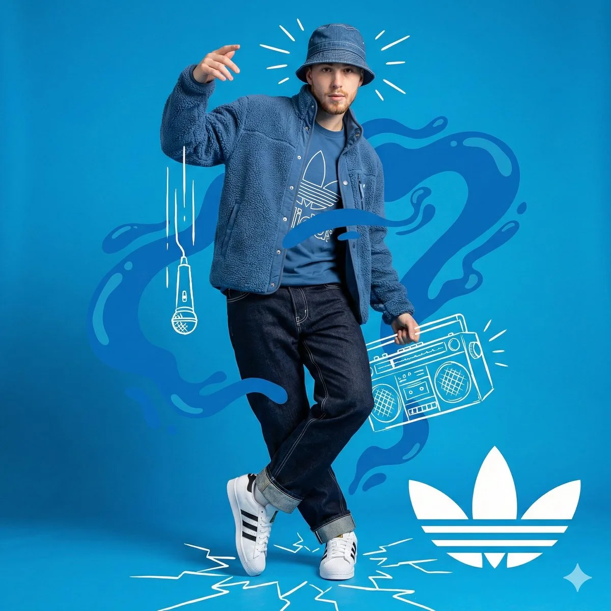

# Heisenberg — by @rovvmut_

[← Back to Community Examples](../../EXAMPLES.md) · Category: Poster Design · Model: `Nano Banana`

<a href="https://x.com/rovvmut_/status/2016070222038602112"></a>

Source: **[@rovvmut_ on X](https://x.com/rovvmut_/status/2016070222038602112)** · Creator: [Heisenberg](https://x.com/rovvmut_)

## Prompt

```text
{
  "meta": {
    "image_quality": "High",
    "image_type": "Mixed Media (Photography combined with Digital Illustration/Collage)",
    "resolution_estimation": "High resolution, sharp edges on vectors",
    "file_characteristics": {
      "compression_artifacts": "Low",
      "noise_level": "None",
      "lens_type_estimation": "Standard to slight wide-angle (approx 35mm)"
    }
  },
  "global_context": {
    "scene_description": "A full-body studio portrait of a young man posing dynamically against a solid bright blue background. The image is a composite featuring the photograph of the man overlaid with white hand-drawn style vector graphics (doodles) and abstract blue liquid shapes. The subject is dressed in a monochromatic blue streetwear outfit with white accents.",
    "environment_type": "Studio/Graphic Design Composition",
    "time_of_day": "Indiscernible (Studio Lighting)",
    "weather_atmosphere": "Energetic, Artistic, Urban, Cool",
    "lighting": {
      "source": "Artificial Studio Lighting",
      "direction": "Front-right dominant (creating soft shadows on the left side of the face)",
      "quality": "Soft, Diffused",
      "color_temperature": "Neutral white"
    },
    "color_palette": {
      "dominant_hex_estimates": [
        "#4CA7E8",
        "#0044CC",
        "#FFFFFF",
        "#1A2B45"
      ],
      "accent_colors": [
        "#FFFFFF"
      ],
      "contrast_level": "High"
    }
  },
  "composition": {
    "camera_angle": "Low-angle (looking slightly up at the subject)",
    "framing": "Full Shot (Head to Toe)",
    "depth_of_field": "Deep (Everything in focus)",
    "focal_point": "Subject's face and upper torso",
    "symmetry_type": "Asymmetrical balance",
    "rule_of_thirds_alignment": "Subject centered, graphics balancing the negative space"
  },
  "objects": [
    {
      "id": "obj_001",
      "label": "Male Subject",
      "category": "Person",
      "location": {
        "relative_position": "Center",
        "bounding_box_percentage": {
          "x": 0.30,
          "y": 0.05,
          "width": 0.40,
          "height": 0.85
        }
      },
      "dimensions_relative": "Large",
      "distance_from_camera": "Mid",
      "pose_orientation": "Standing, body angled slightly right, head tilted left, right hand raised near face, left leg crossed over right leg",
      "material": "Organic (Skin)",
      "surface_properties": {
        "texture": "Skin",
        "reflectivity": "Low",
        "micro_details": "Light goatee/facial hair, neutral but confident expression",
        "wear_state": "N/A"
      },
      "color_details": {
        "base_color_hex": "#5C3A2A",
        "secondary_colors": [],
        "gradient_or_pattern": "Natural skin tones"
      },
      "interaction_with_light": {
        "shadow_casting": "Self-shadows on neck and left side of face",
        "highlight_zones": "Forehead, right cheek, nose bridge",
        "translucency": "None"
      },
      "relationships": [
        {
          "type": "wearing",
          "target_object_id": "obj_002"
        },
        {
          "type": "wearing",
          "target_object_id": "obj_003"
        },
        {
          "type": "wearing",
          "target_object_id": "obj_004"
        },
        {
          "type": "wearing",
          "target_object_id": "obj_005"
        },
        {
          "type": "wearing",
          "target_object_id": "obj_006"
        },
        {
          "type": "interacting_with",
          "target_object_id": "obj_007"
        },
        {
          "type": "standing_on",
          "target_object_id": "obj_011"
        }
      ]
    },
    {
      "id": "obj_002",
      "label": "Bucket Hat",
      "category": "Apparel",
      "location": {
        "relative_position": "Top-Center (On head)",
        "bounding_box_percentage": {
          "x": 0.45,
          "y": 0.05,
          "width": 0.10,
          "height": 0.08
        }
      },
      "dimensions_relative": "Small",
      "distance_from_camera": "Mid",
      "pose_orientation": "Worn on head, brim pulled slightly down",
      "material": "Denim/Canvas",
      "surface_properties": {
        "texture": "Woven fabric",
        "reflectivity": "Low",
        "micro_details": "Visible white contrast stitching around the brim and crown",
        "wear_state": "New"
      },
      "color_details": {
        "base_color_hex": "#003399",
        "secondary_colors": [
          "#FFFFFF"
        ],
        "gradient_or_pattern": "Solid blue with white stitching lines"
      }
    },
    {
      "id": "obj_003",
      "label": "Fleece Jacket",
      "category": "Apparel",
      "location": {
        "relative_position": "Upper Body",
        "bounding_box_percentage": {
          "x": 0.30,
          "y": 0.12,
          "width": 0.35,
          "height": 0.40
        }
      },
      "dimensions_relative": "Medium",
      "distance_from_camera": "Mid",
      "pose_orientation": "Worn open, sleeves rolled slightly or pushed up",
      "material": "Sherpa Fleece / Synthetic Blend",
      "surface_properties": {
        "texture": "High pile, fuzzy, nubby texture on outer shell",
        "reflectivity": "Low (Matte)",
        "micro_details": "Silver snap button visible on collar, smooth fabric lining visible at cuffs",
        "wear_state": "New"
      },
      "color_details": {
        "base_color_hex": "#0044CC",
        "secondary_colors": [
          "#002266"
        ],
        "gradient_or_pattern": "Solid vivid blue"
      }
    },
    {
      "id": "obj_004",
      "label": "T-Shirt",
      "category": "Apparel",
      "location": {
        "relative_position": "Chest/Torso (Under jacket)",
        "bounding_box_percentage": {
          "x": 0.40,
          "y": 0.20,
          "width": 0.20,
          "height": 0.30
        }
      },
      "dimensions_relative": "Medium",
      "distance_from_camera": "Mid",
      "pose_orientation": "Worn on torso",
      "material": "Cotton jersey",
      "surface_properties": {
        "texture": "Smooth fabric",
        "reflectivity": "Low",
        "micro_details": "Large graphic print on chest",
        "wear_state": "New"
      },
      "color_details": {
        "base_color_hex": "#0044CC",
        "secondary_colors": [
          "#FFFFFF"
        ],
        "gradient_or_pattern": "Large white outline of Adidas Trefoil logo on chest"
      },
      "text_content": {
        "raw_text": "adidas (implied by logo shape)",
        "font_style": "Logo symbol",
        "font_weight": "Bold",
        "text_case": "N/A",
        "alignment": "Center",
        "color_hex": "#FFFFFF"
      }
    },
    {
      "id": "obj_005",
      "label": "Jeans",
      "category": "Apparel",
      "location": {
        "relative_position": "Lower Body",
        "bounding_box_percentage": {
          "x": 0.40,
          "y": 0.45,
          "width": 0.20,
          "height": 0.40
        }
      },
      "dimensions_relative": "Medium",
      "distance_from_camera": "Mid",
      "pose_orientation": "Worn on legs, relaxed fit",
      "material": "Denim",
      "surface_properties": {
        "texture": "Woven denim",
        "reflectivity": "Low",
        "micro_details": "Heavy white contrast stitching along seams and pockets. Cuffs are rolled up exposing lighter reverse side of denim.",
        "wear_state": "New"
      },
      "color_details": {
        "base_color_hex": "#2A3B55",
        "secondary_colors": [
          "#FFFFFF",
          "#667788"
        ],
        "gradient_or_pattern": "Dark wash indigo"
      }
    },
    {
      "id": "obj_006",
      "label": "Sneakers",
      "category": "Footwear",
      "location": {
        "relative_position": "Bottom-Center",
        "bounding_box_percentage": {
          "x": 0.35,
          "y": 0.85,
          "width": 0.25,
          "height": 0.10
        }
      },
      "dimensions_relative": "Small",
      "distance_from_camera": "Mid",
      "pose_orientation": "Right foot planted, left foot on toe/mid-step. Classic Adidas Superstar silhouette.",
      "material": "Leather/Rubber",
      "surface_properties": {
        "texture": "Smooth leather upper, textured rubber shell toe",
        "reflectivity": "Medium (Leather sheen)",
        "micro_details": "Three stripes visible (white on white), shell toe pattern",
        "wear_state": "Pristine/Clean"
      },
      "color_details": {
        "base_color_hex": "#FFFFFF",
        "secondary_colors": [],
        "gradient_or_pattern": "All white"
      }
    },
    {
      "id": "obj_007",
      "label": "Graphic - Mic Drop Lines",
      "category": "Illustration/Overlay",
      "location": {
        "relative_position": "Upper Left (Hanging from hand)",
        "bounding_box_percentage": {
          "x": 0.38,
          "y": 0.12,
          "width": 0.05,
          "height": 0.25
        }
      },
      "dimensions_relative": "Small",
      "distance_from_camera": "Zero (Overlay)",
      "pose_orientation": "Vertical",
      "material": "Digital Vector",
      "surface_properties": {
        "texture": "Flat color",
        "reflectivity": "None",
        "micro_details": "Three thick vertical white lines representing motion or cable"
      },
      "color_details": {
        "base_color_hex": "#FFFFFF",
        "secondary_colors": [],
        "gradient_or_pattern": "Solid"
      },
      "relationships": [
        {
          "type": "originating_from",
          "target_object_id": "obj_001"
        }
      ]
    },
    {
      "id": "obj_008",
      "label": "Graphic - Microphone",
      "category": "Illustration/Overlay",
      "location": {
        "relative_position": "Mid Left (Below hand)",
        "bounding_box_percentage": {
          "x": 0.38,
          "y": 0.35,
          "width": 0.05,
          "height": 0.05
        }
      },
      "dimensions_relative": "Small",
      "distance_from_camera": "Zero (Overlay)",
      "pose_orientation": "Angled downwards",
      "material": "Digital Vector",
      "surface_properties": {
        "texture": "Hand-drawn line art style",
        "reflectivity": "None",
        "micro_details": "Outline of a dynamic vocal microphone"
      },
      "color_details": {
        "base_color_hex": "#FFFFFF",
        "secondary_colors": [],
        "gradient_or_pattern": "Outline only"
      }
    },
    {
      "id": "obj_009",
      "label": "Graphic - Boombox",
      "category": "Illustration/Overlay",
      "location": {
        "relative_position": "Center Right",
        "bounding_box_percentage": {
          "x": 0.65,
          "y": 0.30,
          "width": 0.15,
          "height": 0.20
        }
      },
      "dimensions_relative": "Medium",
      "distance_from_camera": "Zero (Overlay)",
      "pose_orientation": "Isometric view",
      "material": "Digital Vector",
      "surface_properties": {
        "texture": "Hand-drawn line art style",
        "reflectivity": "None",
        "micro_details": "Speaker grille mesh pattern, handle, buttons, cassette deck outline"
      },
      "color_details": {
        "base_color_hex": "#FFFFFF",
        "secondary_colors": [],
        "gradient_or_pattern": "Outline only"
      },
      "relationships": [
        {
          "type": "emitting",
          "target_object_id": "obj_013"
        }
      ]
    },
    {
      "id": "obj_010",
      "label": "Graphic - Adidas Trefoil Logo",
      "category": "Illustration/Overlay",
      "location": {
        "relative_position": "Bottom Right",
        "bounding_box_percentage": {
          "x": 0.65,
          "y": 0.65,
          "width": 0.15,
          "height": 0.15
        }
      },
      "dimensions_relative": "Medium",
      "distance_from_camera": "Zero (Overlay)",
      "pose_orientation": "Flat",
      "material": "Digital Vector",
      "surface_properties": {
        "texture": "Flat color",
        "reflectivity": "None",
        "micro_details": "Classic 3-leaf shape with horizontal stripes"
      },
      "color_details": {
        "base_color_hex": "#FFFFFF",
        "secondary_colors": [],
        "gradient_or_pattern": "Solid"
      }
    },
    {
      "id": "obj_011",
      "label": "Graphic - Cracked Floor",
      "category": "Illustration/Overlay",
      "location": {
        "relative_position": "Bottom Center (Under feet)",
        "bounding_box_percentage": {
          "x": 0.25,
          "y": 0.85,
          "width": 0.50,
          "height": 0.15
        }
      },
      "dimensions_relative": "Medium",
      "distance_from_camera": "Zero (Overlay)",
      "pose_orientation": "Flat perspective on ground",
      "material": "Digital Vector",
      "surface_properties": {
        "texture": "Line art",
        "reflectivity": "None",
        "micro_details": "Jagged lines radiating outward from the subject's stance like shattered glass"
      },
      "color_details": {
        "base_color_hex": "#FFFFFF",
        "secondary_colors": [],
        "gradient_or_pattern": "Line art"
      }
    },
    {
      "id": "obj_012",
      "label": "Graphic - Liquid Shapes",
      "category": "Illustration/Background Element",
      "location": {
        "relative_position": "Behind Subject",
        "bounding_box_percentage": {
          "x": 0.10,
          "y": 0.10,
          "width": 0.80,
          "height": 0.80
        }
      },
      "dimensions_relative": "Large",
      "distance_from_camera": "Behind Subject",
      "pose_orientation": "Fluid, amorphous",
      "material": "Digital Vector",
      "surface_properties": {
        "texture": "Flat color",
        "reflectivity": "None",
        "micro_details": "Blobs and splashes extending to the left and right, wrapping slightly around the subject"
      },
      "color_details": {
        "base_color_hex": "#5CAFF0",
        "secondary_colors": [],
        "gradient_or_pattern": "Slightly darker/more saturated than background blue"
      }
    },
    {
      "id": "obj_013",
      "label": "Graphic - Sound/Motion Lines",
      "category": "Illustration/Overlay",
      "location": {
        "relative_position": "Around Head and Boombox",
        "bounding_box_percentage": {
          "x": 0.60,
          "y": 0.05,
          "width": 0.25,
          "height": 0.40
        }
      },
      "dimensions_relative": "Small",
      "distance_from_camera": "Zero (Overlay)",
      "pose_orientation": "Radiating",
      "material": "Digital Vector",
      "surface_properties": {
        "texture": "Line art",
        "reflectivity": "None",
        "micro_details": "Short strokes indicating sound or movement above the hat and next to the boombox"
      },
      "color_details": {
        "base_color_hex": "#FFFFFF",
        "secondary_colors": [],
        "gradient_or_pattern": "Solid"
      }
    }
  ],
  "background_details": {
    "texture": "Digital Flat Color",
    "patterns": "None (Solid Color)",
    "lighting_behavior": "Even illumination, no gradient visible",
    "additional_elements": [
      "Vector liquid shapes (obj_012) act as a secondary background layer"
    ]
  },
  "foreground_elements": {
    "particles": "None",
    "artifacts": "White vector doodles (mic, boombox, cracks) act as foreground overlays"
  },
  "reconstruction_notes": {
    "mandatory_elements_for_recreation": [
      "Male model in full blue Adidas outfit",
      "Fleece texture on jacket",
      "White contrast stitching on jeans and hat",
      "Hand-drawn white doodle overlays (Mic, Boombox, Trefoil)",
      "Cracked floor effect under feet",
      "Monochromatic blue palette with white accents",
      "Dynamic 'cool' pose"
    ],
    "sensitivity_factors": "The blend between the realistic photo and the flat vector graphics must be sharp. The blue tones of the clothing must coordinate with but distinguish from the background blue.",
    "ambiguities": "The exact specific model of the Adidas jacket is not identifiable by name but defined by texture (sherpa/fleece) and color."
  }
}
```

## Try it

Paste the prompt into **[vinano.ai](https://vinano.ai?utm_source=github&utm_medium=readme&utm_campaign=awesome-image-video-prompts-updating&utm_content=x-page-try)** to generate your own version.

> The image and prompt belong to @rovvmut_ ([original post](https://x.com/rovvmut_/status/2016070222038602112)) and are shown here with credit for reference. Creators can ask for changes or removal by opening an issue.
