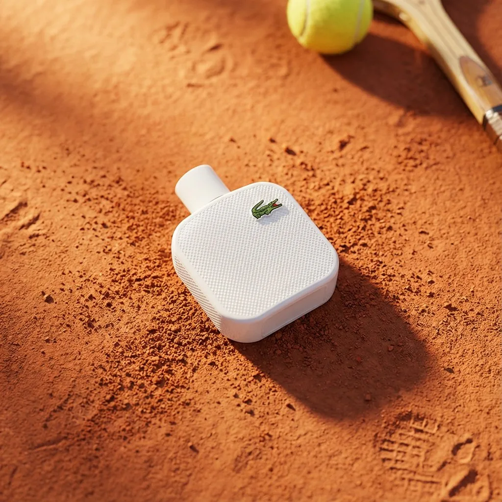

# Mo — by @Kerroudjm

[← Back to Examples from X](../../EXAMPLES.md) · Category: Product & Brand · Model: `Nano Banana`

<a href="https://x.com/Kerroudjm/status/2008559850968473671"></a>

Original post: **[@Kerroudjm on X](https://x.com/Kerroudjm/status/2008559850968473671)** · Creator: [Mo](https://x.com/Kerroudjm)

## Prompt

```text
A high-end editorial photo of a [PRODUCT] placed flat on a [TEXTURED SURFACE], captured from a direct top-down view. The surface is gently disturbed to suggest recent motion or interaction. The front of the product is fully visible and properly oriented upright. The area around the product is intentionally left open to optionally place [COMPLEMENTARY OBJECTS] that visually enhance the scene. Natural sunlight from the upper left casts warm, realistic shadows. 3D realism, luxury product photography, shallow depth of field, 1:1 format.
```

## Try it

Paste the prompt into **[vinano.ai](https://vinano.ai?utm_source=github&utm_medium=readme&utm_campaign=awesome-image-video-prompts-updating&utm_content=x-page-try)** to generate your own version.

> The image and prompt belong to [@Kerroudjm](https://x.com/Kerroudjm) and are shown here with credit for reference. Creators can ask for changes or removal by opening an issue.
