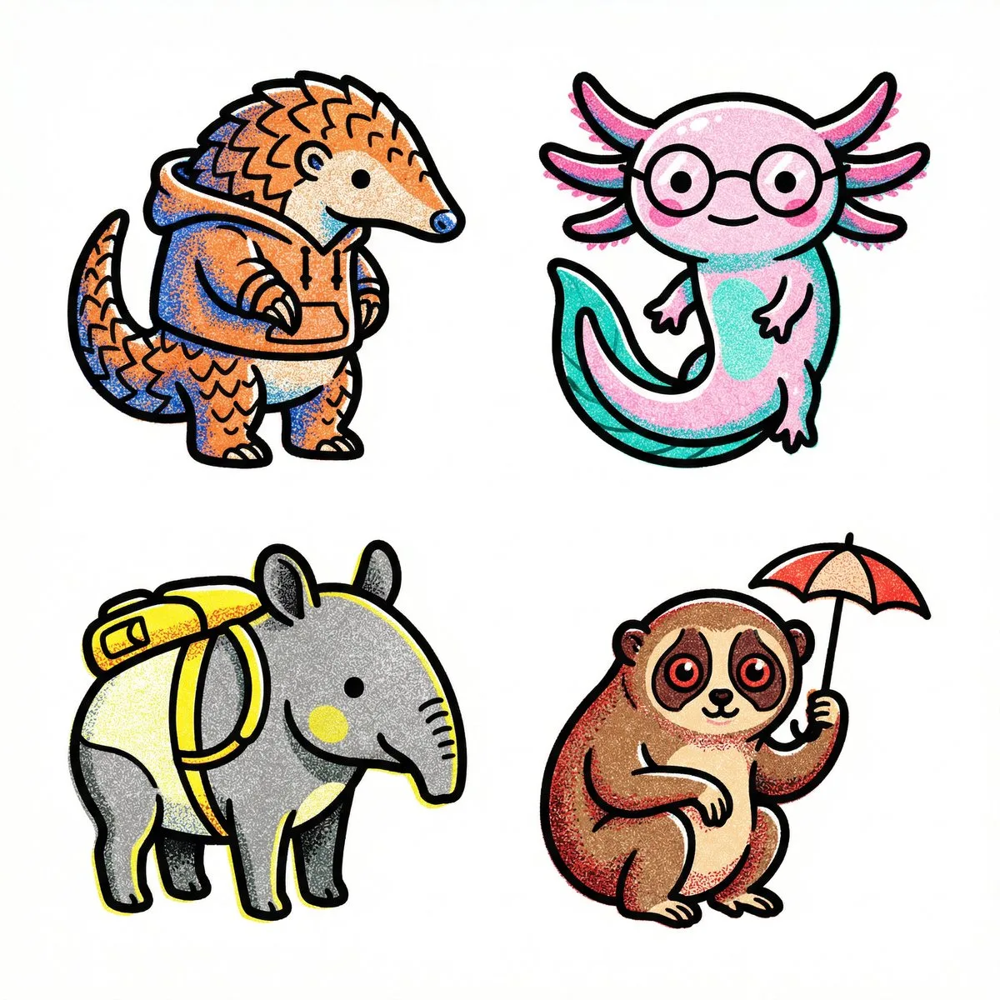

# Nano Banana Pro — by @NanoBanana

[← Back to Community Examples](../../EXAMPLES.md) · Category: UI & Graphic · Model: `Nano Banana`

<a href="https://x.com/NanoBanana/status/2011857121835458929"></a>

Source: **[@NanoBanana on X](https://x.com/NanoBanana/status/2011857121835458929)** · Creator: [Nano Banana Pro](https://x.com/NanoBanana)

## Prompt

```text
Create a collection of icons representing [a theme], they belong together as a single theme. Put them in a 2x2 grid (no lines). The background is pure white. Make the icons as risograph prints. No text. No color distortion. Vibrant and not faded. Stochastic stippling and sand-like noise pattern within color fills. Each icon has a thick black outline.
```

## Try it

Paste the prompt into **[vinano.ai](https://vinano.ai?utm_source=github&utm_medium=readme&utm_campaign=awesome-image-video-prompts-updating&utm_content=x-page-try)** to generate your own version.

> The image and prompt belong to @NanoBanana ([original post](https://x.com/NanoBanana/status/2011857121835458929)) and are shown here with credit for reference. Creators can ask for changes or removal by opening an issue.
