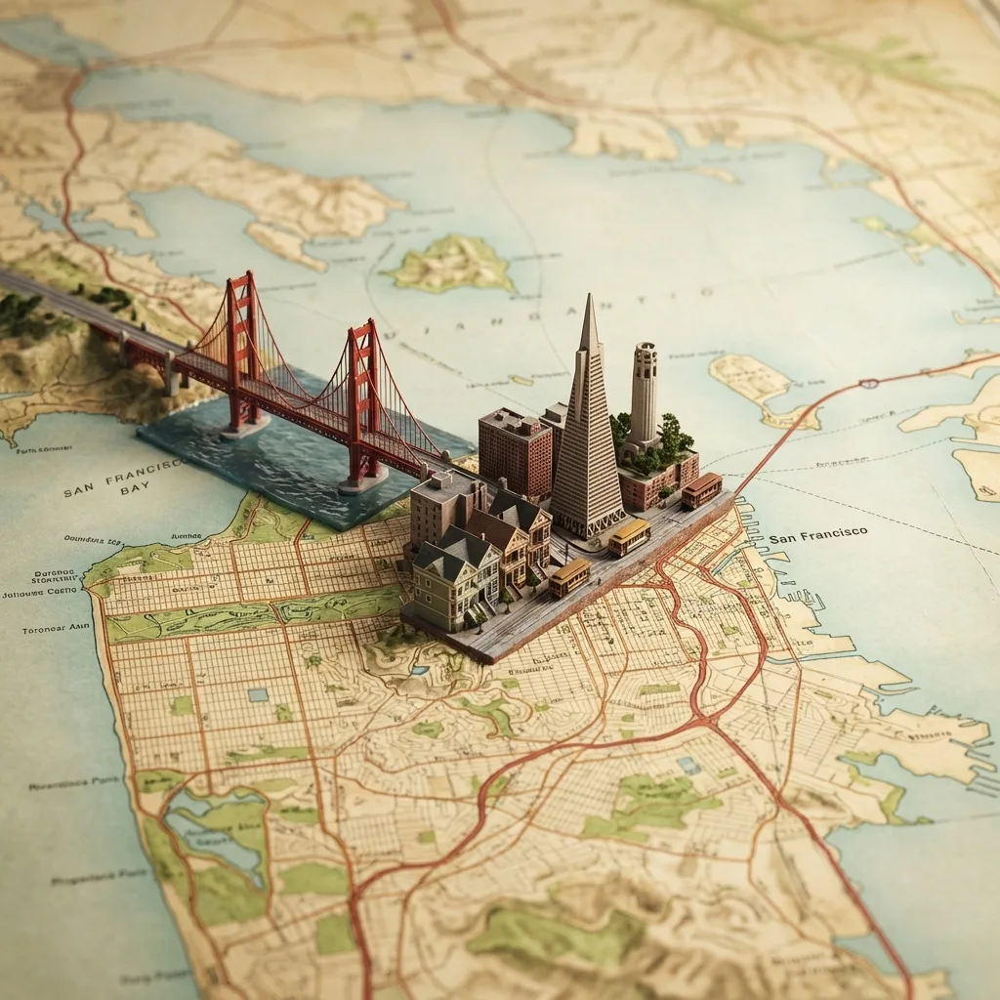

# Mo — by @Kerroudjm

[← Back to Examples from X](../../EXAMPLES.md) · Category: Illustration & 3D · Model: `Nano Banana`

<a href="https://x.com/Kerroudjm/status/2008937653694013753"></a>

Original post: **[@Kerroudjm on X](https://x.com/Kerroudjm/status/2008937653694013753)** · Creator: [Mo](https://x.com/Kerroudjm)

## Prompt

```text
A realistic, highly detailed geographic map viewed from above, accurately representing the region where [COUNTRY] is located. Rising from the map is a miniature 3D diorama of [CITY], precisely positioned at its real geographic location. The diorama features iconic architecture, natural landmarks, and cultural elements seamlessly emerging from the map surface. Ultra-realistic materials, fine textures, and depth of field. Soft studio lighting with subtle shadows, cinematic composition, premium macro photography style. Square 1:1 format, high detail, realistic scale.
```

## Try it

Paste the prompt into **[vinano.ai](https://vinano.ai?utm_source=github&utm_medium=readme&utm_campaign=awesome-image-video-prompts-updating&utm_content=x-page-try)** to generate your own version.

> The image and prompt belong to [@Kerroudjm](https://x.com/Kerroudjm) and are shown here with credit for reference. Creators can ask for changes or removal by opening an issue.
