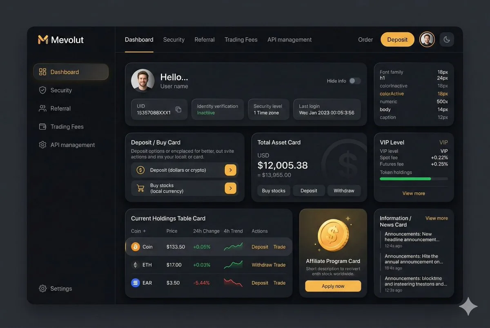

# Dan ⚡️ — by @d4m1n

[← Back to Community Examples](../../EXAMPLES.md) · Category: UI & Graphic · Model: `Nano Banana`

<a href="https://x.com/d4m1n/status/2027064868847689902"></a>

Source: **[@d4m1n on X](https://x.com/d4m1n/status/2027064868847689902)** · Creator: [Dan ⚡️](https://x.com/d4m1n)

## Prompt

```text
You are an experienced UI designer embracing modern, minimalistic design, shadows, glass, and soft colors.

Your role is to create a professional, beautiful mockup that is ready for delivery based on these requirements: 

<requirements>
## 1. Overall Style & Visual Language
This interface represents a premium, modern fintech / crypto trading dashboard using a dark theme.  
The visual language combines **soft neumorphism**, and **luxury Web3 aesthetics**.

Core characteristics:
- Warm gold/orange accent highlights
- Monochromatic color palette with minimalistic effects and shadows
- Card-based layout with depth and subtle backgrounds
- Minimal borders, separation via shadows or light backgrounds

Target perception:
- Secure
- Professional
- High-end / institutional-grade
- Optimized for experienced traders

---

## 2. Layout Structure

### Global Layout
- Desktop-first dashboard
- Output proportions: 3:2
- Three main regions:
  1. Top navigation bar (horizontal)
  2. Left sidebar navigation (vertical)
  3. Main content area (multi-column grid of cards)

Spacing is generous, prioritizing clarity and visual breathing room.

---

## 3. Top Navigation Bar
- Height: 72px
- Left:
  - Brand logo text "Mevolut"
  - Stylized "M"
  - Gold/orange accent
- Center:
  - Navigation links: Dashboard, Security, Referral, Trading Fees, API management
- Right:
  - Order link
  - Primary CTA: “Deposit” (gold pill button)
  - User avatar (circular)
  - Theme toggle (moon icon)

Typography:
- Clean sans-serif
- Medium weight
- White primary text, muted gray inactive states

---

## 4. Left Sidebar Navigation
- Width: 240px
- Background: near-black
- Vertical navigation items with icons:
  - Dashboard (active)
  - Security
  - Referral
  - Trading Fees
  - API management
- Bottom-aligned:
  - Settings

Active item:
- Subtle background highlight
- Slight background tint
- Rounded container

Icons:
- Outline style
- Gold accent on active state

---

## 5. Main Content Area

### 5.1 User Overview Card
- Large rounded card at top
- Left:
  - Circular avatar
  - Greeting text (“Hello…”)
  - User name
- Inline info blocks:
  - UID (copy icon)
  - Identity verification status
  - Security level
  - Time zone
  - Last login timestamp
- Right:
  - “Hide info” toggle

Style:
- Subtle inner shadows

---

### 5.2 Deposit / Buy Card
- Medium-sized card
- Title text explaining deposit options
- Two action rows:
  - Deposit (dollars or crypto)
  - Buy stocks (local currency)
- Each row:
  - Icon
  - Label
  - Arrow action button (gold accent)

---

### 5.3 Total Asset Card
- Displays USD balance and USD equivalent
- Large, faded Dollar symbol watermark in background
- Action tabs:
  - Buy stocks
  - Deposit
  - Withdraw
- Numeric values are large

---

### 5.4 VIP Level Card
- Shows current VIP level
- Spot and futures fee rates
- Progress bar for token holdings
- “View more” link

Progress bar:
- Rounded
- Dark background track

---

### 5.5 Current Holdings Table
- Card containing a table layout
- Columns:
  - Coin (icon + name)
  - Price
  - 24h Change
  - 4h Trend (sparkline)
  - Actions (Deposit, Withdraw, Trade)

Sparklines:
- Green for positive trend
- Red for negative trend

Hover:
- Subtle background highlight per row

---

### 5.6 Affiliate Program Card
- Promotional card
- Gold coin illustration
- Short description and CTA button (“Apply now”)

---

### 5.7 Information / News Card
- Vertical list of announcements
- Headline + timestamp
- “View more” link at top

---

## 6. Color Palette
- Primary background: deep charcoal / black
- Card surfaces: slightly lighter
- Accent color: warm gold
- Text hierarchy:
  - White (primary)
  - Muted gray (secondary)
  - Dark gray (disabled)
- Status colors:
  - Green for positive
  - Red for negative

---

## 7. Effects & Interaction
- Rounded corners throughout (sm)

# Design tokens:
{
  // Global theme definition
  "theme": {
    "mode": "dark",
    "style": [
      "soft-neumorphism",
      "premium-fintech"
    ]
  },

  // Layout measurements and structure
  "layout": {
    "type": "desktop-dashboard",
    "grid": "three-column",
    "sidebarWidth": 240,
    "topbarHeight": 68,
    "contentPadding": 24
  },

  // Color system
  "colors": {
    "background": "#0B0D10",        // Main app background
    "primaryAccent": "#F5A623",     // Gold/orange highlight
    "secondaryAccent": "#FFB547",
    "textPrimary": "#FFFFFF",
    "textSecondary": "#B0B3B8",
    "textMuted": "#6B6F76",
    "success": "#22C55E",
    "danger": "#EF4444"
  },

  // Typography scale
  "typography": {
    "fontFamily": "SF Pro, system-ui, sans-serif",
    "weights": {
      "heading": 600,
      "body": 400,
      "numeric": 500
    },
    "sizes": {
      "h1": 24,
      "h2": 20,
      "h3": 16,
      "body": 14,
      "caption": 12
    }
  },

  // Core UI components
  "components": {
    "card": {
      "borderRadius": 16,
      "shadow": "0 20px 40px rgba(0,0,0,0.4)",
      "border": "none",
      "background": "#14171C",
    },

    "button": {
      "primary": {
        "textColor": "#0B0D10",
        "borderRadius": 999,
      },
      "secondary": {
        "background": "transparent",
        "textColor": "#F5A623"
      }
    },

    "sidebar": {
      "background": "#0E1014",
      "itemRadius": 12,
      "iconStyle": "outline"
    },

    "table": {
      "rowHeight": 56,
      "divider": "subtle",
      "hoverHighlight": true,
      "sparkline": {
        "positiveColor": "#22C55E",
        "negativeColor": "#EF4444"
      }
    },

    "progressBar": {
      "height": 6,
      "radius": 999,
      "fillColor": "#22C55E",
      "backgroundColor": "#2A2E35"
    }
  },

  // Icon system
  "icons": {
    "style": "outline",
    "size": 18,
    "colorInactive": "#6B6F76",
    "colorActive": "#F5A623"
  }
}
</requirements>
```

## Try it

Paste the prompt into **[vinano.ai](https://vinano.ai?utm_source=github&utm_medium=readme&utm_campaign=awesome-image-video-prompts-updating&utm_content=x-page-try)** to generate your own version.

> The image and prompt belong to @d4m1n ([original post](https://x.com/d4m1n/status/2027064868847689902)) and are shown here with credit for reference. Creators can ask for changes or removal by opening an issue.
