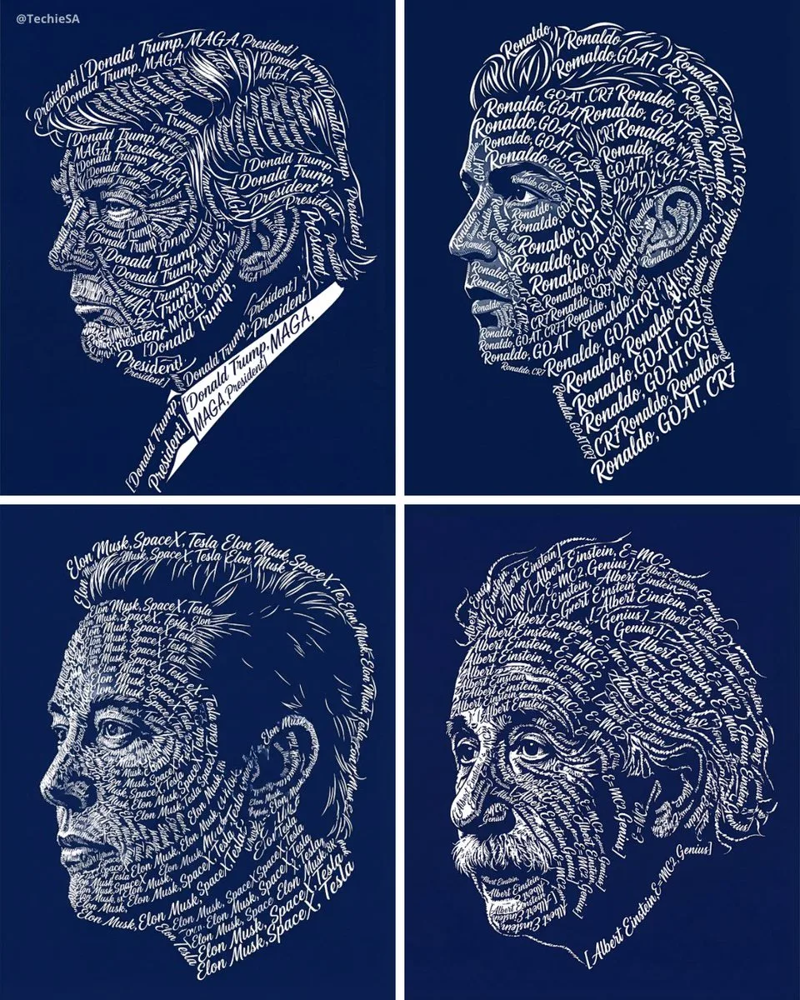

# TechieSA — by @TechieBySA

[← Back to Examples from X](../../EXAMPLES.md) · Category: UI & Graphic · Model: `Nano Banana`

<a href="https://x.com/TechieBySA/status/2022996169698545867"></a>

Original post: **[@TechieBySA on X](https://x.com/TechieBySA/status/2022996169698545867)** · Creator: [TechieSA](https://x.com/TechieBySA)

## Prompt

```text
Create a typographic art portrait using the uploaded photo of a person as reference. Display a left-facing side profile portrait. The entire image--including the face. hair. and facial features--must be formed exclusively from repeated white calligraphic text using the words: "[PUT WHATEVER WORDS YOU WANT HERE]" The text should follow the natural contours of the face and hair, clearly shaping the person's profile silhouette. Use a deep navy blue background with high contrast The stvle should be clean vector art with sharp edges. Output in high-resolution 8K quality. Do not alter the person's facial identity. No additional colors. no textures. and no watermark. Dimension 4:5
```

## Try it

Paste the prompt into **[vinano.ai](https://vinano.ai?utm_source=github&utm_medium=readme&utm_campaign=awesome-image-video-prompts-updating&utm_content=x-page-try)** to generate your own version.

> The image and prompt belong to [@TechieBySA](https://x.com/TechieBySA) and are shown here with credit for reference. Creators can ask for changes or removal by opening an issue.
