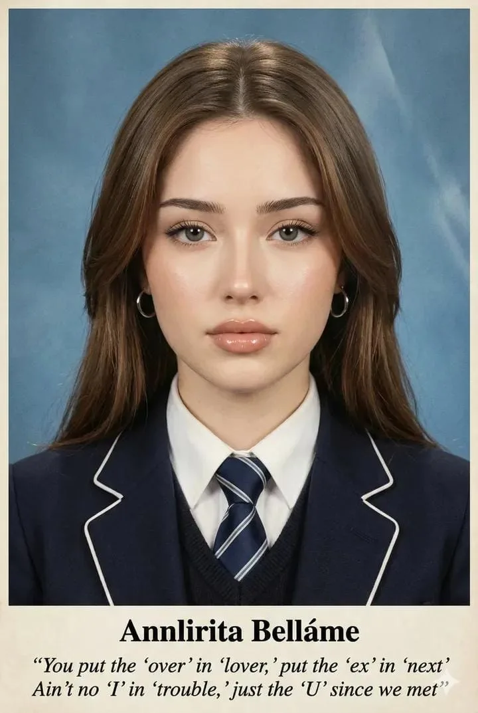

# simply — by @kingofdairyque

[← Back to Community Examples](../../EXAMPLES.md) · Category: Photography · Model: `Nano Banana`

<a href="https://x.com/kingofdairyque/status/2008441233816109505"></a>

Source: **[@kingofdairyque on X](https://x.com/kingofdairyque/status/2008441233816109505)** · Creator: [simply](https://x.com/kingofdairyque)

## Prompt

```text
Use this photo attached to create an ultra-realistic printed portrait with authentic photo-print shine.
A straight-on, centered head-and-shoulders portrait of a young woman, neutral confident expression, eyes looking directly at the camera. Composition is perfectly aligned and symmetrical, identical to a school ID / yearbook / magazine archive photo.
She has long, smooth brown hair, center-parted, softly layered, neatly styled. Makeup is polished but natural, editorial-clean: warm brown eyeshadow, softly defined eyeliner, voluminous lashes, subtle contour, peach blush, and glossy nude lips. Skin is smooth, flawless, softly matte with natural highlights, realistic pores visible.
She wears a dark navy blazer with white piping, white collared shirt, dark sweater vest, and navy striped tie, styled like a formal school uniform portrait. Small silver hoop earrings.
EXACT FILTER & PRINT SHINE (VERY IMPORTANT):
Apply a real photo-print filter, not digital glow:
Subtle semi-gloss paper sheen
Light reflective shine across cheeks, forehead, and lips, as if light is bouncing off printed ink
Very mild lamination glare, thin diagonal highlights
Slight softening from ink absorption, not blur
Gentle warm undertone from printed ink
Fine paper grain texture visible on skin and background
Looks like a scanned or photographed printed photo
NO glassy skin
NO beauty filter glow
NO cinematic bloom
LIGHTING:
Direct frontal harsh flash ALWAYS ON, similar to ID or studio flash:
Even exposure
Bright eye catchlights
Minimal shadows
Flat, clean lighting typical of printed portraits
BACKGROUND:
Flat cool blue textured studio backdrop, evenly lit, slightly muted by print ink.
TEXT & LAYOUT (PRINTED):
Below the portrait, centered and printed on the page:
Bold serif font:
HIGHSCHOOL GAL
Below in smaller italic serif font, quotation style:
“You put the ‘over’ in ‘lover,’ put the ‘ex’ in ‘next’
Ain’t no ‘I’ in ‘trouble,’ just the ‘U’ since we met”
Text appears ink-printed, slightly imperfect edges, natural spacing, no digital sharpness.
OVERALL LOOK:
Real printed photograph
Magazine / yearbook archive
Soft shine, subtle glare
Paper texture + ink warmth
Not digital, not glossy poster
Looks physically touchable
```

## Try it

Paste the prompt into **[vinano.ai](https://vinano.ai?utm_source=github&utm_medium=readme&utm_campaign=awesome-image-video-prompts-updating&utm_content=x-page-try)** to generate your own version.

> The image and prompt belong to @kingofdairyque ([original post](https://x.com/kingofdairyque/status/2008441233816109505)) and are shown here with credit for reference. Creators can ask for changes or removal by opening an issue.
