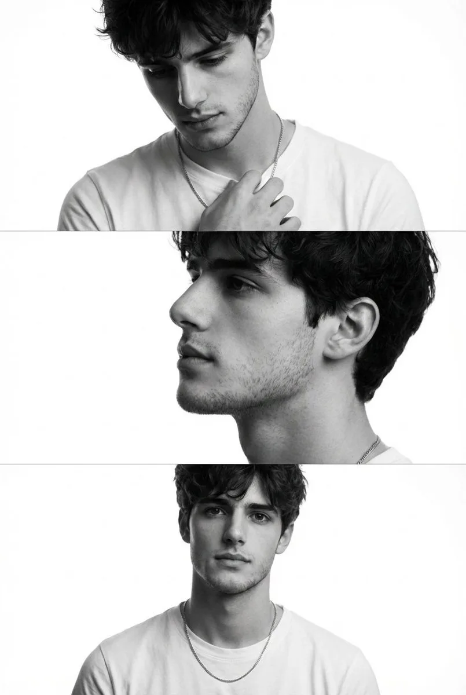

# Harboriis — by @harboriis

[← Back to Community Examples](../../EXAMPLES.md) · Category: Photography · Model: `Nano Banana`

<a href="https://x.com/harboriis/status/2023230471061315992"></a>

Source: **[@harboriis on X](https://x.com/harboriis/status/2023230471061315992)** · Creator: [Harboriis](https://x.com/harboriis)

## Prompt

```text
Preserve the face, proportions, and external features of the model as in the reference. A minimalist monochrome fashion editorial triptych featuring three stacked cinematic frames. The subject is a young man with short dark hair and a groomed beard. Frame 1: Emotional and introspective, looking downward with a hand near the collarbone, highlighting bone structure with Rembrandt lighting. Frame 2: A crisp profile shot with a focus on the nose, lips, and masculine jawline, gaze directed slightly upward. Frame 3: A frontal, thoughtful portrait with shoulders relaxed and direct eye contact. The composition is clean and modern, using a white T-shirt and gold necklace for visual continuity. Commercial magazine quality, high-end mirrorless camera, authentic skin pores, soft bokeh, and elegant masculinity.
```

## Try it

Paste the prompt into **[vinano.ai](https://vinano.ai?utm_source=github&utm_medium=readme&utm_campaign=awesome-image-video-prompts-updating&utm_content=x-page-try)** to generate your own version.

> The image and prompt belong to @harboriis ([original post](https://x.com/harboriis/status/2023230471061315992)) and are shown here with credit for reference. Creators can ask for changes or removal by opening an issue.
